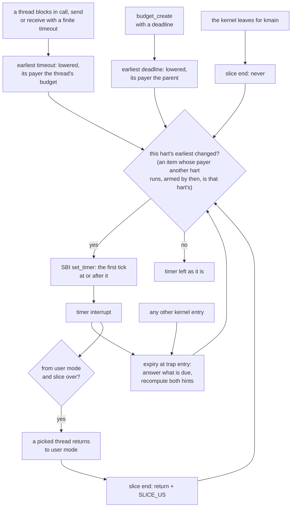

# Time and timeouts

The kernel owns each hart's timer and keeps it armed for the earliest thing
due: its running thread's slice end, a blocking call's timeout or a budget's deadline. Time is
monotonic microseconds since the kernel started, read with `time_now`; user mode also reads the
raw counter with `rdtime`. Every blocking call takes a timeout, and a budget with a deadline is
destroyed when it passes. No process programs the timer, and the kernel keeps no date.

## Purpose

Time is how the kernel keeps its promises to waiting threads and to whoever grants a lease. A
caller must never block past its timeout because a server stalls or a spinner holds the CPU. A
lease must end when its deadline passes, whatever the budget inside it is doing. So the timer is
the kernel's alone, it is armed whenever anything is due, and every kernel entry answers what
has passed before it does anything else.

## Interface

### Time

Status: built · partly tested: that `time_now` counts from the kernel's start is not checked by a case · tested: bench:timeouts, bench:timeouts-tcg, host:redoubt-sys::every_result_and_error_round_trips

| Source | Unit | What it is |
| --- | --- | --- |
| `time_now` | microseconds | Monotonic time since the kernel started, rounded down. No arguments, no errors; the value comes back as one 64-bit result in two registers ([ABI](abi.md)). |
| `rdtime` | timebase ticks | The hardware `time` counter, read directly in user mode (the kernel sets `scounteren.TM`). It counts from reset, not from boot. On rv32 a program reads `rdtimeh`, `rdtime`, `rdtimeh` and retries until the high halves agree. |

`time_now` is the clock with a unit. `rdtime` is for fine relative timing: it costs no kernel
entry and resolves single ticks. No call returns the timebase frequency; a program that needs
ticks per microsecond measures `rdtime` against `time_now` over a sleep. Microseconds in a `u64`
last about 584,000 years, so the kernel never handles a wrap; every sum saturates instead.

The loader reads the frequency from the device tree (`/cpus/timebase-frequency`) and passes it
in the `Time` tag of the argument block ([boot](boot.md)). The kernel converts with it both
ways: ticks to microseconds rounding down, microseconds to ticks rounding up. So a timer set for
a time never fires before `time_now` reaches it.

### The hart timer

Status: built · partly tested: that a budget deadline's stale early hint costs one early interrupt and misses nothing is argued from the code, not attacked · tested (15)

- bench:timeouts
- bench:budget-deadline
- bench:sched-timer-flood
- bench:timeout-hint-exit
- bench:sched-share
- bench:sched-timer-entry
- bench:deadline-placement
- bench:timer-flood-at-rest
- mutation:TimeoutIgnoredWhileOthersRun
- host:redoubt-stride::a_hint_is_lowered_and_a_tie_of_payers_belongs_to_every_hart
- host:redoubt-stride::each_item_is_armed_on_a_hart_that_runs_its_payer_or_on_one_hart
- host:redoubt-stride::a_hart_covers_an_item_only_when_armed_at_or_before_it
- host:redoubt-stride::an_item_stays_covered_when_the_hart_that_covered_it_switches_away
- host:redoubt-stride::a_payer_nowhere_item_stays_covered_across_the_covering_harts_slice_end
- host:redoubt-ipclist::timed_waits_stay_in_deadline_order

The kernel keeps three times (`kernel/src/time.rs`) and arms the hardware for the earliest:
- the **slice end** of each hart's running thread: set to the time plus `SLICE_US` (1,000 µs) when a
  thread `kmain` picked returns to user mode, and to never while `kmain` itself runs and from a
  pick until that return ([R12 (scheduling)](scheduling.md#r12-scheduling));
- the **earliest timeout** of any blocked thread;
- the **earliest deadline** of any budget.

The last two are hints. A thread that blocks with a timeout, or a new deadline, lowers its hint at
once; a call that does not block lowers nothing. The timeouts' hint is exact. Each process keeps its
waits with a deadline in deadline order, the walk to a wait's place its own call's, so the first is
the process's earliest timeout, which it caches; a wait that ends before its timeout and was first
raises the cache to the next one's, and a wait whose deadline was the hint marks the hint stale. A
call, an expiry or an interrupt's delivery that ends such waits recomputes the hint from the caches
once, one read per live process, however many it ends (an exit, a destruction, an expiry's pumps):
at its end, and first wherever the hint is read before then. So a wait answered early leaves no walk
behind, and the next re-arm comes by the next item; a hart already armed for the ended wait that
passes no re-arm before it still takes that interrupt, which finds nothing. `sched-timer-flood`'s
waits answered 15 ms before their timeouts leave no timer interrupt that finds a wait ended early
(none on either width). `timeout-hint-exit`'s exit of a process whose 254 waits each hold the hint
in turn, with every other PID holding a later timeout, holds the kernel 5,200 ticks longer on rv64
and 6,765 on rv32 than the same exit on an empty system, 0.52 and 0.68 of a slice under `icount` in
a checked build: the one recomputation, within the two slices the case allows. Two checks catch a
hint that is not exact, and not the same faults. A cache left early makes an expiry walk that finds
nothing due, which the trace records and the bench's `no_stale_waits_in` refuses. A hint left early
while every cache is exact makes an interrupt whose walk skips every process, which the trace does
not tell from one that found nothing to do: only the checked build's audit catches it, asserting at
an entry's end that the hint is the caches' earliest, as it asserts at every audit of the lists that
each cache is its process's first deadline. The deadlines' hint is only ever early: a budget
destroyed by hand leaves it where it was, which costs one early interrupt and one walk that
recomputes it; nothing is missed. The kernel re-arms only when the earliest time changes, and only
on its way to where a timer interrupt can be taken: the return to user mode, `kmain`'s idle, and a
timer interrupt taken in that idle, which returns there. What changes the earliest time in between
(a call that blocks with a timeout, a new deadline, a slice's end, the interrupt that fired) only
records it. So a preemption arms the timer once, at the return to the thread `kmain` picks. Each
arming is one `ecall` to the firmware, through the SBI TIME extension
(`kernel/src/arch/riscv/timer_sbi.rs`). With nothing due at all (the kernel idle, no timeouts, no
deadlines) the timer is set to never.

**Whose hart comes by an item.** Each hint carries the id of the budget that pays for its item: a
timeout's, the blocked thread's budget; a deadline's, the dying budget's parent (the bill at the
destruction may go to an ancestor with free weight; the placement reads the parent). A hart arms
its timer for an item if it runs the payer, or if no other hart that runs the payer is armed at
or before it (a timer that has just fired and is being re-armed counts as armed); when no hart
runs the payer, or two payers tie at the instant (the hint then names none), a hart arms it
unless any other hart is armed at or before it; otherwise that hart's timer comes by it. So the
work the item makes, the timeout's answer or the whole destruction, lands on its payer's hart
where the payer runs, in the payer's own time, and not in another budget's slice ([R12 for timer
work](#r12-scheduling-for-timer-work)); where the payer runs nowhere, the common case for a
timeout (a budget with one thread blocks to wait), it lands on one hart, the first to re-arm
since the item was noted or the hint moved: usually the hart its thread left, which re-arms at
that very return or idle, but the choice is path-dependent (a hart running another budget may be
it, and then the interrupt is billed to the item's payer as any timer work is), and what the rule
bounds is the count of harts an item wakes, one, not which. Before, every hart's timer came by
such an item, so at rest, where every blocked budget's payer runs nowhere, each timeout woke
every hart and all but one took the kernel lock for nothing: the launched system at the prompt
(`bench:launch-idle`, four harts, 60 s windows) took 197 timer interrupts a window on rv64 (173
on rv32) for about 65 timeouts, the lock changed hands 371 times (313) with each hand-off an
interrupt to the halted waiter, and the kernel re-armed the timer 345 times (319); with the rule,
five windows a width, 63 to 70 timer interrupts, 100 to 115 hand-offs (a woken thread's own
calls meeting another hart's entry, no longer the harts waking for nothing) and 194 to 199
re-arms (three a timeout: the noting hart's, the slice end's at the thread's return, the next
item's at its idle), the busiest hart from 3.5 interrupts a second to 1.6 to 1.9 and two harts
under 0.3, often without a timer interrupt in the whole window. The decision is a pure function of
the hint, the harts' runners and what each timer is armed for (`redoubt_stride::Hint::due_on`,
read at each re-arm from the scheduler's runners, one read per hart; the deadline list is never
scanned on the way to user mode), and it keeps the liveness the plain rule had: at every return
to user mode and before every idle, at least one hart is armed at or before each kind's earliest
item, which the host tests above hold over random runner sets, re-armed in turn as the harts do
under the kernel lock; a hart that covers an item re-arms at every exit and either keeps it,
finding no other hart covering, or sees another that does, and one that covered it only by its
own earlier slice end re-arms at that end and then arms the item. At one hart nothing changes:
there is no other hart to cover an item.

While a user thread runs, its slice end is always pending. So the kernel is always entered
within one slice, whatever the thread does. The kernel itself runs with supervisor interrupts
off. A timer interrupt is taken from user mode, or while `kmain` sleeps in `wfi` with nothing
runnable; a time that passed while the kernel was busy is already pending, so `wfi` returns at
once.

*Figure: what arms the timer. Every arrow is built; nothing in user space reaches the timer.*

### Timeouts and `FOREVER`

Status: built · tested (5)

- bench:timeouts
- bench:timeouts-tcg
- bench:sched-wake-no-preempt
- mutation:R12TimeoutWakePreempts
- host:redoubt-rt::sleep_zero_is_one_receive_from_nothing_that_returns_at_once

`call`, `send` and `receive` each take a **timeout**: relative microseconds from the moment the
call is made. The kernel adds it to the current time with saturation, so the deadline it
records never wraps. `FOREVER` (`u64::MAX`) never expires, and neither does any timeout large
enough to saturate. There is no maximum timeout and no minimum. A timeout of 0 is a poll: the
call delivers what it can at once and otherwise returns `Timeout` without blocking.

A **sleep** is `receive` with no handle: it can only time out. The Rust runtime's `sleep`
(`libs/rt/src/handle.rs`) is exactly that. `sleep(0)` is the runtime's yield: it enters the kernel
and returns at once. Redoubt's kernel runs no other thread first: a deadline already past times out
without blocking, and the caller resumes without the scheduler picking again. A backend that
switches threads cooperatively switches there.

When a timeout passes, the blocked call returns `Timeout` with what it waited for unwound. A
queued `call` or `send` gets its buffer back. A `call` the server already took is abandoned: the
lend is consumed and the server gets one abandoned-call notice
([IPC](ipc.md#how-a-call-completes)). A `receive` on an endpoint or an interrupt simply ends.

A timeout **wakes**; it does not preempt. At the first kernel entry at or after the deadline
the kernel commits the `Timeout` result and makes the thread runnable. When it then runs is the
scheduler's choice under R12 (scheduling) ([scheduling](scheduling.md#r12-scheduling)): a
thread whose timeout falls mid-slice runs when that slice ends, or later.

### Budget deadlines

Status: built · partly tested: that a destroyed child's later deadline is dropped is seen only as the kernel surviving it · tested: bench:budget-deadline, bench:sched-latency, mutation:BudgetDeadlineIgnored

A budget's **deadline** is absolute microseconds since boot, set once by its creator in
`budget_create`; `FOREVER` means none. The field and what a lease is belong to
[budgets](budgets.md#deadlines); this section is how the timer fires it.

The kernel links every budget with a deadline into one list, so finding the next deadline never
scans every budget. When a deadline passes, the kernel destroys the budget and its subtree
exactly as `budget_destroy` does, with nobody asking ([R10 (destruction)](budgets.md#r10-destruction)):
every process in it is killed (an exit notice, where one is sent, blames nobody), its calls
are failed or abandoned, and every handle to it or stamped with it is revoked. A deadline already past at
`budget_create` destroys the budget at the next kernel entry, so the handle the caller receives
is dead by the time it can use it.

A child's own deadline may be later than its parent's. It never fires then: the parent's
destruction takes the child with it, and a destroyed budget leaves the list.

A deadline is a preemption point (R12). If a deadline fires at a kernel entry from user mode,
the entering thread gives up the CPU before its trap is handled. If its own process was
destroyed, nothing of it is left to handle. Otherwise its trap is taken again when it next
runs.

### Expiry

Status: built · partly tested: the order at an equal instant is attacked only in the model · tested: bench:budget-deadline, bench:timeouts, bench:expiry-deadline-then-timeout, mutation:ExpireBudgetsFirst

**Expiry** answers everything due at or before the current time. It runs first at every kernel
entry except `kmain`'s switch to a thread, before anything reads the entering process. `kmain`
itself expires, then picks, then switches, with no kernel entry between. So a time that has
passed beats any operation that enters after it.

Expiry takes the earliest item first. At an equal instant, timeouts come before deadlines;
timeouts among themselves go in (pid, tid) order, and deadlines by budget id. The order
matters: a caller whose taken call times out at the instant its server's budget reaches its
deadline gets `Timeout` with its lend consumed, not `Dead` with it returned.

Finding what is due reads the waits with a deadline of each process whose cached earliest
timeout has come, which each process keeps on a list of its own in deadline order, up to the
first still to come, and walks the deadline list. Both are skipped while the hints are in the
future. After expiry the kernel recomputes both hints,
and the timer is armed for them on the way out (above).

### Wall-clock time and time sync

Status: planned · M6 (persist, install, share)

The kernel keeps no date: `time_now`, timeouts, slices and deadlines stay monotonic time
since boot. Wall-clock time (dates, time zones) is a user-space offset over
`time_now`. A server holds the offset and answers it on an endpoint. At boot it sets the offset
from the board's real-time clock, reached as a device object by its driver
([devices](devices.md)). While the box runs, it corrects the offset by an authenticated time
source reached through [`gatewayd`](../servers/gatewayd.md). Every date a server stamps (audit
records, file times, certificate checks) comes from this offset. A lease granted for a wall-clock span is turned into a deadline in
`time_now` units when it is granted, so a wrong or attacked wall clock can mislabel logs and
files but cannot lengthen a lease or a timeout.

**Open:** which server owns the offset (the steward, the RTC driver or a server of its own);
which authenticated source syncs it (NTS, Roughtime) and what happens with no network; whether
TLS certificate checks in `gatewayd` (M5 (self-hosted development)) need wall time earlier;
whether a correction may step the offset backwards or only slews it; how the offset persists
across reboots and how a clock set backwards is detected; how audit records bind monotonic and
wall time.

## Authority

Status: built · tested: bench:timeouts, bench:budget-deadline, bench:legacy-gone

- **Reading time needs no handle.** Every process may call `time_now` and read `rdtime`. Time
  is not a capability, because hiding it protects nothing (see Why).
- **Nothing in user space programs the timer.** There is no timer call, no timer device object
  and no timer interrupt a process can receive. Numbers outside the call table are refused
  ([ABI](abi.md)). A process affects the timer only by running (its slice), by its own
  timeouts and by the deadlines of budgets it creates.
- **A deadline is chosen once, by the creator.** `budget_create` takes it from whoever holds a
  handle to the parent budget. No call changes it later. The holder of a handle to the budget
  can end it sooner with `budget_destroy` ([budgets](budgets.md)).
- **A timeout is the caller's own.** It bounds only the calling thread's wait; no argument sets
  another thread's.

## Security properties

### I13 (every blocking call returns by its timeout), on the timer

Status: built · partly tested: timeouts on more than one hart are not attacked by a case · tested (5)

- bench:timeouts
- bench:timeouts-tcg
- bench:sched-latency
- bench:sched-wake-no-preempt
- mutation:TimeoutIgnoredWhileOthersRun

I13 is owned by [invariants](invariants.md#i13-every-blocking-call-returns-by-its-timeout); this
is how the timer keeps it. No thread stays blocked past its timeout. The timer is armed for the
earliest timeout whether or not another thread runs, and every kernel entry expires first. The
conversion rounds up, so no timeout ends early. `FOREVER` and saturated timeouts are the only
ones that never end. A reply racing a timeout lands on exactly one side: either the caller gets
the reply and the server `delivered`, or the caller gets `Timeout` and the server `discarded`
(R13 (one outcome per call), [IPC](ipc.md#r13-one-outcome-per-call)).

"Returns by" means the result is committed and the thread is runnable. It runs when R12 picks
it, and a wake never preempts; the bench measures that delay as a target, not a bound
([scheduling](scheduling.md)).

### R10 (destruction) at a deadline: a passed deadline comes first

Status: built · partly tested: a process entering the kernel in a tight loop to put its deadline off is not attacked by a case · tested: bench:budget-deadline, mutation:BudgetDeadlineIgnored

R10 is owned by [budgets](budgets.md#r10-destruction), which states the deadline path and the
equal-instant order; this is how the timer keeps it. A budget whose deadline has passed is
destroyed before any operation that enters the kernel at or after that instant, because
`expire_due` (`kernel/src/time.rs`) runs first at every kernel entry. Nothing defers expiry: no kernel state, no interrupt handling and no
call a process can make postpones it. A budget cannot outlive its deadline by spinning, because
its slice end brings the kernel back, nor by blocking, because the timer is armed for the
deadline itself. The only delay is the kernel work already in progress when the deadline passes.

### R12 (scheduling) for timer work

Status: built · tested: bench:sched-timer-flood, bench:deadline-flood-billed, bench:sched-exit-churn, bench:deadline-placement, bench:deadline-flood-billed-traced-mttcg, bench:sched-exit-churn-mttcg, mutation:R12TimerWorkUnbilled

R12 is owned by [scheduling](scheduling.md#r12-scheduling); this is how its charging applies to the
timer's work. Each expired item's work is billed under it: a timeout to its thread's budget, a
deadline's whole destruction to the dying budget's parent, after its carve returns, or to the
nearest ancestor with free weight above 0 ([scheduling](scheduling.md#charging)). The one walk that
finds what is due, and its ordering by deadline, is billed in equal shares to the items it handles,
each with its own ending, so a budget pays for its own share of a shared instant, not a neighbour's.
The timer is armed for a timeout only when its thread blocks, so a call whose timeout has passed, or
that is answered at once, arms nothing. A wait that ends before its timeout leaves nothing for the
timer ([the hart timer](#the-hart-timer)): its cache's rise is one read, and the hint's
recomputation one read per live process, once in the call or expiry that ended it however many such
waits it ended, and so that one's payer's; the walk to a wait's place among its process's timed
waits is the blocking call's own. An expiry reads a process's waits due and the next, not every
timed wait, so its time is the waits it ends; it falls inside the slice of the thread the timer
interrupted, though billed to the payers ([scheduling](scheduling.md#r12-scheduling)). The rest of
the entry, the timer's own handling, goes to the budget whose item it found last, so the budget the
timer interrupted pays for none of it. Each bill closes its interval at the tick that opens the
next, and the last opens the rest of the entry's, so a timeout's bill never leaves its own handling
between two intervals, nobody's; a deadline's destruction still does
([scheduling](scheduling.md#residual-risks)). So a process that arms many timers a microsecond
apart, or creates many budgets with staggered deadlines, spends its own CPU share, not a
neighbour's.

On several harts the bill is right, and the hart is the payer's where the payer runs: a hart's
timer comes by a timeout or a deadline only if it runs the budget that pays for it, or no hart
does, or the payer's hart is not yet armed by then ([the hart timer](#the-hart-timer)). Before, every hart's timer came by the earliest of each,
so the hart that answered one was often running another budget, whose thread waited out the
payer's work; a pick repays that only where it can, and a budget with one thread beside a payer
with one, on two harts, cannot take a second hart. The traced kernel's oracle reports the timer
interrupts from user mode that charged a budget other than the one they interrupted, with their
ticks, and a case bounds them inside a victim's window as a share of what the victim was charged
(`foreign_timer_in`, [the scheduler oracle](../testbench.md#the-scheduler-oracle)), at 10 of
1000 at two harts, where the harts run at once (multi-threaded TCG, host time, on the quiet core
set): `deadline-placement`, whose creator makes its deadlines 600 µs ahead and then only spins,
reads 0 to 1 of 1000 in five runs a width, and a kernel built with `timer-any-hart`, every hart's
timer coming by every item as before, fails it at 21 (rv64, 74 such interrupts, 251,881 ticks)
and 29 (rv32, 89, 364,375), the recorded negative runs; `deadline-flood-billed-traced-mttcg`
reads 1 to 4 with 16 deadlines and 0 to 1 with 64, `sched-exit-churn-mttcg` 0 (rv64) and 1 to 5
(rv32) against threads that exit and 0 against the processes, five runs a width each. Before the
placement, at two harts: in `sched-exit-churn` against threads that exit, the attacker's poll
timeouts, 27 such interrupts and 70,232 ticks on rv64 (0.23 % of the window's charges), 8 and
17,035 on rv32; in `deadline-flood-billed-traced` with 16 deadlines, where the destructions landed
decided the victim's share: mostly on the creator's hart, 3 such interrupts and 34,046 ticks
(rv32) and the victim kept 872 of 1000; mostly on the victim's (87 of 96, rv64), 89 and 833,543
ticks, 17 % of the window's charges, and it kept 482, against at least 450. Under icount the
count is not the placement's but the order of QEMU's turns, and a run locks into one phase: the
icount cases report it and bound nothing by it ([a hart waits for QEMU's
turns](scheduling.md#residual-risks)).

What still lands elsewhere, and is counted, not excluded: a payer that runs nowhere (a
one-thread budget waiting on its own timeout), whose item one hart comes by, the first to re-arm,
usually the one its thread left but not always, so a victim beside such a poller may answer some
of its timeouts (before the one-hart rule, every hart came by it and a victim answered about half:
`sched-exit-churn` under icount, 20 of 1000 of the victim's charges, 164 interrupts, on rv64 and 0
on rv32 in one run each, which phase the run locked into); two payers at one instant, whose
items are one hart's the same way; an item noted on a hart
that does not run its payer, which that hart arms too until the payer's hart next re-arms; an
item whose payer was destroyed and its id reused before the expiry recomputed the hint, which is
placed as the new holder of the id runs until then (the placement alone, never the bill); and any
item that has passed when some other entry comes, a call's, or a slice's end through `kmain` or
inside its own interrupt, which serves it there (I13 and R10 order every passed item first, on
any hart). The last is a flood's: the payer's hart is inside one destruction with interrupts off
while the next deadline passes, and the victim's own slice-end interrupt reaches it first, the
destruction landing there; under icount, where the victim's slice end runs 0.7 ms ahead of the
payer's exact-time interrupt in QEMU's turns and the 26 ms destruction cycle keeps that phase,
`deadline-flood-billed-traced` read 114 of 1000 of the victim's charges with 16 deadlines and
235 and 241 with 64 in two runs of one bundle on rv64 (0 in another, 0 and 1 on rv32), what the
residual can cost under one clock. Device interrupts are placed by the controller, not the payer
([IRQ1's residual](devices.md#residual-risks)). The deadline notice at two harts
(`sched-latency`, net p99 at N = 1, 4 and 16): before the placement 3,297, 3,409 and 3,764 µs on
rv64, 3,985, 4,079 and 5,093 on rv32; with it 3,535, 3,428 and 3,758 and 3,933, 4,104 and 5,133,
every move within the same program's p99 kernel section (10,167 ticks on rv64 and 11,053 on
rv32, 1.0 to 1.1 ms, with `hold-trace`), the cost of waiting for the payer's hart;
`kernel-containment` at two harts 24,001 from 24,027 and 27,120 from 27,349.

## Failure and restart

Status: built · partly tested: a boot with no `Time` tag is not attacked by a case · tested: bench:budget-deadline, bench:timeouts

- **No timebase, no boot.** If the argument block has no `Time` tag, or it is 0, the kernel stops
  at start and powers off, because no timeout, slice or deadline would mean anything
  (R17 (fail closed), [boot](boot.md#r17-fail-closed)).
- **A deadline hits the running process.** The budget is destroyed with the process that was
  interrupted killed last; the kernel then runs whatever is current and never resumes the dead
  thread.
- **A server holds a call past its caller's timeout.** The caller gets `Timeout` and its lend is
  consumed; the server keeps the call open until it replies (R3 (lends and abandoned calls),
  [IPC](ipc.md#r3-lends-and-abandoned-calls)).
- **A reboot resets time.** `time_now` starts again from 0. No timeout or deadline survives,
  because no thread or budget does.
- No timeout or deadline value, however large, can make the kernel panic: every sum
  saturates and every conversion is checked (I14 (no call panics the kernel)).

## Residual risks

- **A timeout is a wake, not a run.** I13 bounds when the result is committed, not when the
  thread runs. Under load a woken thread waits for R12's turn. The bench holds lateness to
  1,000 µs for an idle sleep and asserts wake targets under load only in virtual time
  (`bench:timeouts`, `bench:sched-latency`); `bench:timeouts-tcg` reports real-time lateness
  without judging it.
- **Timer work can still land on another budget's hart.** An item is armed on its payer's hart
  where the payer runs; one whose payer runs nowhere or ties with another is armed on one hart,
  the first to re-arm, whichever that is; one noted on a hart that does not run its payer until
  the payer's hart re-arms, one whose destroyed payer's id was reused before the hint was
  recomputed, and one that has passed when some other entry comes are answered where they are.
  The oracle counts them and three cases bound the count inside a victim's window ([R12 for
  timer work](#r12-scheduling-for-timer-work)).
- **Kernel work is not interrupted.** The kernel runs with interrupts off, so a timeout or
  deadline that passes during a long kernel operation (a budget's destruction, a large range
  call) is answered when that operation ends, and one armed on its payer's hart, or on the one
  hart that covers an item whose payer runs nowhere, waits for that hart to leave the kernel,
  where an idle hart would have answered it at once: the cost of waking one hart instead of every
  hart is a wake's latency, bounded by the covering hart's kernel section
  ([the hart timer](#the-hart-timer)). Re-judged at two harts with the rule, every target met:
  `bench:sched-latency`'s deadline notice net p99 at N = 1, 4 and 16 rose by 0.2 to 0.4 ms on
  both widths (rv64 3,763, 3,874 and 4,076 µs from 3,535, 3,428 and 3,758; rv32 4,302, 4,390 and
  5,407 from 3,933, 4,104 and 5,133), within the program's p99 kernel section of 1.0 to 1.1 ms;
  its timer wake at N = 16 by 1.6 and 3.7 ms (10,702 and 21,463 from 9,132 and 17,714) while at
  N = 1 it and the driver wake fell. The N = 16 rise is more than a section, and its mechanism is
  the rule itself under a burst of timeouts: sixteen sleepers' timeouts, every payer running
  nowhere while it sleeps, are armed on one hart, so their wakes are served there in turn while
  the other hart idles, where before each hart answered about half of them. It is a cost of the
  one-hart rule, not of a kernel section, and it has a trigger: if that timer wake's p99 at N = 16
  nears its 50 ms target, or a workload shows sleepers bursting on one hart, the covering hart
  hands the items due beyond the first to an idle hart, or an idle hart is preferred to cover.
  `bench:kernel-containment`'s deadline notice 24,529 and
  27,882 from 24,001 and 27,120. At one hart nothing moved. `bench:budget-deadline` bounds a deadline's
  lateness by the cost of the same destruction by hand plus 1,000 µs. The frames such an
  operation freed are zeroed by an idle hart, one frame a pass with interrupts off (about 30 µs),
  only while every hart is idle, and on demand by an allocation that finds no free frame
  ([frames in flight](memory.md#frames-in-flight)), so the zeroing adds at most one frame to an
  interrupt's wait, on any hart count.
- **Every process has a perfect clock.** `rdtime` resolves single ticks and `time_now` single
  microseconds, and both are free to read. Anything a process can time, it learns. Timing and
  covert channels are out of scope ([TENETS](../TENETS.md#threat-model)).
- **The timebase is the platform's word.** The frequency comes from the device tree, which the
  bundle's signature does not cover ([boot](boot.md)). A wrong value scales every timeout, slice
  and deadline alike. Only the firmware and the emulator or board supply it, and they are TCB.
- **The firmware arms the timer.** The kernel does not check the result of the SBI `set_timer`
  call. A firmware that failed to arm it would stop slices, timeouts and deadlines. The firmware
  is TCB ([boot](boot.md)).
- **Expiry walks the processes.** An expiry reads every live process's earliest timeout
  (`MAX_PROCESS_COUNT`, 511, a compile-time constant no process can change) and, in those whose
  earliest timeout has come, only their waits due and the first still to come, never their other
  threads or their waits not yet due, plus the deadline list. So a process's timed waits still to
  come cost an expiry one read: with 253 of one process's waits pending and every PID in use, a
  timer interrupt's expiry takes 5 µs median and 537 µs at most before its slice decision on rv64 in
  a checked build (`bench:timeout-hint-exit`'s fill), where reading every timed wait of the process
  takes 1,327 µs median; the exact caches it rests on are what `bench:sched-timer-flood` checks,
  with no timer interrupt finding a wait ended early. One walk finds every wait due and orders them
  by deadline, so a deadline that ends many waits at once walks once, and ordering its R waits takes
  R log R steps; both are billed in equal shares to the waits it found. At full occupancy, every PID
  in use with every thread, the walk that finds 250 waits due at once takes 26.8 ms on rv64 and 28.9
  ms on rv32, within R12's 30 (`bench:worst-walk`). A budget destroyed before its deadline leaves
  the timer early: one walk of the deadline list, nobody's, for each such destruction, which its
  destroyer pays for in full. Keeping the timeouts' hint exact costs a call that blocks one step per
  wait of its own process due no later (at most `MAX_THREADS`, 255, its own threads), and an entry
  that ends a wait holding the hint one read per live process (at most 511), once however many it
  ends, as an expiry's walk reads them: 0.52 of a slice at full occupancy, every PID holding a
  timeout, on rv64 and 0.68 on rv32 (`bench:timeout-hint-exit`, whose exit of 254 timed waits holds
  the kernel 17 to 19 ms in all, the rest its own threads' ends, as on an empty system).
- **Equal-instant order is argued, not attacked.** Timeouts before deadlines at one instant is
  checked by the model's mutation only; no bench case lands a timeout and a deadline on the same
  microsecond.
- **A destroyed child's later deadline** is shown dropped only by the kernel surviving past it:
  `bench:budget-deadline` cannot observe the deadline list directly.

## Why

- **The kernel owns the timer.** Timeouts and deadlines are promises the kernel makes; a timer
  server could be starved or killed and take every promise with it. So there is no timer server,
  no timer interrupt for user space and no call that programs the hardware.
- **Always armed for the earliest.** One target, the minimum of three, is the whole design. The
  slice end alone guarantees the kernel back within 1 ms of any user code, so expiry never
  depends on a thread choosing to enter.
- **Expire first, at every entry.** A deadline that passed must win over whatever the entering
  thread asks for; checking first makes that true at every entry without a special case per call.
- **Exact timeouts, early deadlines.** A late hint would break I13; an early one costs a spare
  interrupt and a walk. A timeout ends early all the time (every call answered before it), and an
  early hint left for each would wake a hart for nothing at rest and move the timer twice, so the
  timeouts' hint is kept exact: the order a process keeps its timed waits in makes raising its
  cache one read, paid by the call that blocks, and the hint is recomputed only in an entry that
  ended the wait that held it, once. A deadline ends early only by a destruction, so its hint is
  only lowered.
- **Relative timeouts, absolute deadlines.** A timeout is how long the caller will wait from the
  moment it asks, so it is relative and cannot be stale. A deadline is when a lease ends,
  whatever happens to its creator meanwhile, so it is absolute.
- **Microseconds in the interface, ticks inside.** Microseconds are the same on every board, so
  programs and the model need no frequency. Charging CPU time in ticks is the scheduler's
  business ([scheduling](scheduling.md)).
- **`rdtime` is open, and its frequency is not a call.** Hiding time protects nothing: an
  attacker can count loop iterations just as well ([TENETS](../TENETS.md#threat-model)).
  `time_now` is the clock with a unit, so the kernel keeps no second way to learn one.
- **SBI TIME, not Sstc.** It works under every SBI firmware on both widths with no firmware
  configuration (Sstc needs `menvcfg.STCE`), and one `ecall` per arming is nothing against a
  1 ms slice.
- **Timeouts first at an equal instant**, so a caller whose server's lease ends at its own timeout
  sees the timeout it asked for, with the lend accounting that goes with it.
- **No date in the kernel.** Wall-clock time comes from outside the box and can be wrong or
  attacked. Keeping it in user space means no kernel rule depends on it.
