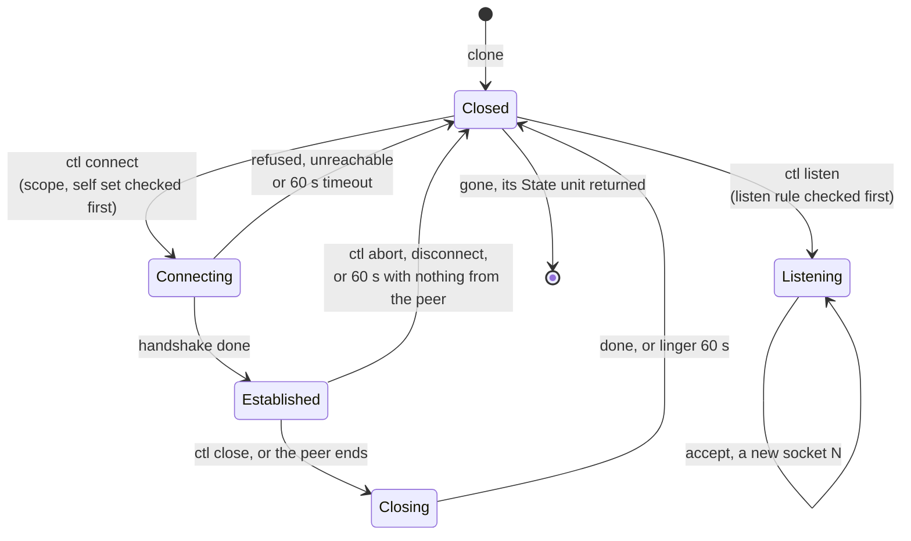

# ipd

`ipd` is the TCP/IP stack for one network: it serves `/net` over 9P, a Plan 9 style tree of TCP
sockets, and talks to the network card through [`netd`](netd.md). A socket capability is a
connection to `/net` carrying a **scope** of IP prefixes and ports; a connection reaches only what
its scope allows and never the box's own addresses, whatever the scope says. `ipd` is a sink: it
refuses every labelled caller. It runs smoltcp 0.14.0, vendored, with IPv4, Ethernet and TCP only.

## Purpose

People's sessions need the network, and the network is where data leaves the box; agents reach it
only through `gatewayd`, never a socket of their own. `ipd` puts the rule at the socket: a capability names exactly the prefixes and ports it may connect to or
listen on, a grant can only narrow it, and no scope can reach back into the box, where a forwarded
port could lead a session to `approve@box`. Because `ipd` is a sink, no labelled data reaches it
at all.

## Interface

### The `/net` tree

<details><summary>Status: built · tested (15)</summary>

- bench:net-tcp
- bench:ipd-host-tests
- host:redoubt-ipd::clone_makes_a_socket_and_tcp_lists_only_the_callers
- host:redoubt-ipd::a_connect_waits_then_carries_data_through_the_files
- host:redoubt-ipd::ctl_refusals_are_named_and_checked_before_the_stack
- host:redoubt-ipd::a_listener_accepts_through_ctl
- host:redoubt-ipd::numbers_are_per_connection_and_invisible_to_others
- host:redoubt-ipd::a_connection_carries_bytes_both_ways_and_ends
- host:redoubt-ipd::a_far_host_is_reached_through_the_gateway
- host:redoubt-ipd::a_write_waits_while_the_send_buffer_is_full
- host:redoubt-ipd::a_listener_accepts_its_backlog_and_listens_again
- host:redoubt-ipd::a_silent_socket_survives_all_but_its_last_lost_keep_alive_answer
- host:redoubt-ipd::a_silent_socket_lives_through_a_stall_after_a_lost_answer_until_its_timeout
- host:redoubt-ipd::the_conformance_vectors_run_against_ipd
- host:redoubt-ipd::a_client_connects_and_echoes_through_the_program

</details>

`/net` is served over the [9P server skeleton](serving.md#the-9p-server-skeleton). Everything a
file holds is typed, in the wire encoding ([wire](wire.md#the-encoding)), never text.

```
/              the connection's root; it carries the connection's scope
/tcp/          lists only this connection's sockets
/tcp/clone     read at offset 0: a new socket N, as n: u32
/tcp/N/ctl     write: one net_ctl operation; read: state: u32, n: u32 (waits)
/tcp/N/data    read: bytes (waits; 0 bytes is the peer's end); write: bytes (waits)
/tcp/N/remote  read: addr: bytes[4] (network order), port: u16
```
*The tree one connection sees.*

- **`clone`**: a read at offset 0 makes a new socket, charged to the caller, and returns its number,
  the lowest free one for this connection. `/tcp` lists only the connection's own sockets, and a
  walk to another connection's number is "not found".
- **`ctl`**: a write is one `net_ctl` operation, its opcode as a `u32` then its fields
  ([wire](wire.md#the-message-convention)): `connect(addr, port)`, `listen(port, backlog)` (backlog
  at most 8), `close` (the graceful end) or `abort`. A read returns the state (1 connecting,
  2 established, 3 closing, 4 closed, 5 listening) and, for a listener that accepted, the new
  socket's number; it **waits** while a connect is in progress or a listener has nothing accepted,
  at most `CTL_WAIT_US` (8 s), then `timeout`, and the client asks again.
- **`data`**: the byte stream. A read waits while there is nothing to read, a write while the send
  buffer (8 KiB) is full; either at most `DATA_WAIT_US` (8 s), then `timeout`, and the client asks
  again; bytes that arrive after a read's `timeout` wait in the socket's buffer for the next read.
  Waiting calls are parked ([parked calls](serving.md#parked-calls)), for strictly less than their
  clients wait ([pinned and abandoned calls](#pinned-and-abandoned-calls)).
- **A socket lives** until `close`, `abort`, or the `disconnect` of its connection (which aborts
  every socket of it), then lingers at most 60 s before `ipd` resets it, plus TCP's TIME-WAIT; it
  stays charged to its owner until it is gone. An established socket that hears nothing from its
  peer for 60 s (`IDLE_TIMEOUT`) is ended; a half-open one gives its slot back after 3 s.
- **A silent socket is probed** so that a lost frame does not end it. Frames are lost on the way
  in: `netd` drops one `ipd` has not taken within 50 ms ([netd](netd.md#serving-ipd)), and nothing
  sends a probe's answer again; two such drops in a minute is the most the bench has shown
  plausible under load. A keep-alive goes out after 15 s without a frame sent (`KEEP_ALIVE`: the
  timeout over `PROBES` + 1, `PROBES` = 3), so three probes go out before the timeout, and a
  silent socket lives through two lost answers in a row. It also lives through `ipd` getting no
  turn right after a probe whose answer it lost, if its next turn comes before the timeout since
  the last frame in, under 45 s after that probe: it probes then and takes the answer. Measured
  against that margin under a whole rv64 class's load (`lease-writes`' idle session, probed every
  30 s then): `netd` dropped one frame, during boot, `ipd` never woke a second or more past a
  deadline, and every answer came within a millisecond but one, which the host took 4.15 s to
  send.
- **What a probe costs.** One probe is `ipd`'s timer wake, its `transmit` call to `netd`, the
  card's interrupt for the answer, `netd`'s receive thread's send to `ipd`, and `ipd`'s wake: on
  an idle four-hart box about 66 cross-hart interrupts and 84 SBI calls in all, measured in
  `launch-idle` with the keep-alive at 10 s (an idle SSH session's socket, six probes a minute
  against two). At four probes a
  minute the busiest hart there reads 2.9 to 3.5 interrupts a second against 2.4 to 2.8 at two,
  under its ceiling of 3.8. That is the box's cost of any one small frame and its answer at rest,
  not the probe's, and is a finding of its own; the probe interval follows from the loss model
  above, not from it.
- **Ports.** A listened port belongs to its connection and the connections `new_connection` minted
  from it, not to grants; an ephemeral port is drawn at random and drawn again if in use.
- **What is not there:** no IPv6, DHCP, DNS, UDP, raw or ICMP sockets, and no fragment reassembly (a
  fragment is dropped). Non-TCP IPv4 and datagrams from martian sources get no answer.


*Figure: a TCP socket's states as its `ctl` file reports them.*

The table: [libs/wire/tables/net_ctl.md](../../libs/wire/tables/net_ctl.md).

{{#include ../../libs/wire/tables/net_ctl.md:tables}}

### Scopes and grants

<details><summary>Status: built · tested (13)</summary>

- bench:net-attacks
- host:redoubt-ipd::a_scope_permits_exactly_what_its_rules_contain
- host:redoubt-ipd::a_granted_connection_in_a_scope_ends_when_the_scope_is_destroyed
- host:redoubt-ipd::a_grant_is_minted_in_the_revocation_scope_it_brings
- host:redoubt-ipd::a_grant_only_narrows
- host:redoubt-ipd::a_grant_never_widens_or_adds_listen
- host:redoubt-ipd::the_encoding_is_canonical_and_round_trips
- host:redoubt-ipd::only_a_root_badge_with_a_scope_attaches
- host:redoubt-ipd::new_connection_keeps_the_scope
- host:redoubt-ipd::a_grant_narrows_and_disconnect_frees_everything
- host:redoubt-ipd::grant_mints_a_narrower_connection
- host:redoubt-ipd::a_grant_nobody_received_is_undone
- host:redoubt-ipd::connects_outside_the_scope_or_to_the_box_are_refused_and_send_nothing

</details>

- **A scope** is at most `MAX_RULES` (8) rules, each a **connect** rule (an IPv4 prefix and a port
  range) or a **listen** rule (a port range). A connection may connect to an address and port only
  if some connect rule contains both, and listen on a port only if some listen rule contains it
  ([R58 (a scope reaches only what it allows)](#r58-a-scope-reaches-only-what-it-allows)).
- **Where scopes come from.** A root badge's scope is in `ipd`'s arguments; only a root badge with a
  scope may attach. A connection minted by `new_connection` keeps its parent's scope (rooted at `""`
  or `"tcp"` only). A connection made by `grant` has the scope the grant asked for.
- **`grant(scope)`** mints a connection whose scope is `scope`, only if every rule of it lies inside
  one rule of the caller's own, of the same kind, prefix within prefix and ports within ports. So a
  grant never widens a scope or adds `listen` to it
  ([R61 (scopes only narrow)](#r61-scopes-only-narrow)). It replies with the connection and its id,
  and follows the typed grant pattern ([wire](wire.md#granting-and-releasing)); the connection is
  an ordinary one in the skeleton's table (`mint_rooted`), freed by `disconnect`, and undone if its
  reply is lost. Its one optional handle slot, `revocation: handle[0]? budget`, is the revocation
  budget the connection is minted in, what `new_connection`'s `scope` slot names
  ([wire](wire.md#ninep_common)), called `revocation` here because on this page a scope is the
  prefixes and ports a connection may reach: the skeleton stamps the handle with it, so
  destroying the budget ends the connection in every table at once, and `ipd` closes the handle
  once minted with; a budget not below `ipd`'s own stamp is the kernel's refusal, answered
  `not_permitted` ([R41 (narrowing by revocation scope)](steward.md#r41-narrowing-by-revocation-scope)).
  The steward sends a session's or lease's revocation budget with every grant it asks for.
- **The scope's encoding** in a `grant`: `count: u8`, then per rule `kind: u8` (1 connect,
  2 listen), `addr: bytes[4]` (network order; zero for listen), `len: u8` (zero for listen),
  `lo: u16`, `hi: u16`. It is canonical and round-trips.
- **Scopes are kept by an id never reused**, so a node that outlives its connection names no scope,
  which permits nothing.
- Refusals are checked before smoltcp sees the operation, so a refused connect sends nothing.

The table: [libs/wire/tables/ipd.md](../../libs/wire/tables/ipd.md).

{{#include ../../libs/wire/tables/ipd.md:tables}}

`frame` is `netd`'s: each received frame, as a `send` on the ingress badge with the frame in one
transferred page ([netd](netd.md#serving-ipd)). Frames count only from the unlabelled ingress badge.

### The box's own addresses

<details><summary>Status: built · tested (4)</summary>

- bench:net-attacks
- bench:bench-net-self-unrefused
- host:redoubt-ipd::the_self_set
- host:redoubt-ipd::connects_outside_the_scope_or_to_the_box_are_refused_and_send_nothing

</details>

Before any scope is looked at, `ipd` refuses every address of the box itself: its own address, its
network's network and broadcast addresses, the limited broadcast, the loopback and "this host"
networks, multicast, the reserved class E, and every `self=` prefix its arguments list (on QEMU
`10.0.2.0/24`, which the emulator maps to the host, where a forwarded port leads back to the
guest). So a manifest that wrongly scoped `0.0.0.0/0` still cannot reach the box
([R59 (never the box's own addresses)](#r59-never-the-boxs-own-addresses)). `net-attacks` tries
a forwarded self address, `ipd`'s own address, loopback and the gateway from a scope allowing
everything, and checks the capture shows no SYN to them; the broadcast, "this host", multicast and
class E refusals are attacked by the host test `the_self_set`;
`bench-net-self-unrefused` is the same boot without the `self=` entry, and must fail, which proves the
case catches a missing check.

### Labelled callers

Status: built · tested: bench:net-attacks, host:redoubt-ipd::a_labelled_caller_gets_nothing_and_holds_no_bucket, host:redoubt-ipd::frames_count_only_from_the_unlabelled_ingress_badge

`ipd` is a sink, cleared for nothing. A caller whose message carries any label is refused before
its request is decoded: before 9P, `ninep_common`, `grant` or admission. So it opens no bucket and
cannot even make a socket by reading `clone`, which the label check alone would let it read
([R60 (a sink refuses labels)](#r60-a-sink-refuses-labels)).

### Pinned and abandoned calls

<details><summary>Status: built · tested (6)</summary>

- bench:net-pinned
- bench:net-pinned-ssh
- host:redoubt-ipd::parked_calls_are_freed_when_abandoned_and_capped_by_the_share
- host:redoubt-ipd::two_reads_one_byte_one_answer_and_ipd_goes_on
- host:redoubt-ipd::an_accept_nobody_answers_ends_with_the_ctl_deadline
- host:redoubt-ipd::a_data_read_with_nothing_coming_ends_with_the_data_deadline_and_late_bytes_wait_for_the_next

</details>

Every waiting read or write is parked with a server-side deadline, in the caller's bucket and share
([R28 (parked-call accounting)](serving.md#r28-parked-call-accounting)); it is served again once
the stack says it would not wait, and an abandoned one is answered at once. The stack is polled only
right after a `receive` that returned something other than a call, so no call is current while
smoltcp runs, and a crash inside it blames no parked caller
([R21 (crash blame)](../kernel/processes.md#r21-crash-blame)).

**A call is parked for strictly less than its client waits.** A client that gives up on a request
drops the answer that comes later (the beamlet hub at `FILE_WAIT_US`, 10 s, retiring the fid:
[files over 9P](../userland/files.md#files-over-9p)); a `data` read's answer carries bytes, which
no retry can ask for again, so an answer dropped that way is lost to the stream. `ipd` therefore
answers `timeout` first: `DATA_WAIT_US` and `CTL_WAIT_US` are 8 s, the 10 s less a 2 s margin,
a round figure far above what it covers (the kernel's delivery of the reply, microseconds), so
the only answer a client could drop is one whose delivery took longer than the margin. Bytes arriving after the `timeout` wait
in the socket's buffer for the next read, which the client makes at once (`sshd`'s reader asks
again on `timeout`; the hub answers its caller `etimedout`, who asks again; a session's `gen_tcp`
read abandons its parked read when the caller's own `recv` timeout fires, and parks the next read
when the caller asks again); `ctl` is asked again the same way, and finds the same state. In
`net-pinned` a client abandons 64 parked reads, each answered and freed; a read
with nothing coming ends at the `data` deadline, a listener's `ctl` read at the `ctl` one, and the
connection still works after; the host test parks a read on an established connection, sees it
wait at `DATA_WAIT_US - 1` and end at `DATA_WAIT_US`, then has the peer send and the next read
answered at once with the bytes. `net-pinned-ssh` runs the same abandon-and-free from a session's
`gen_tcp` over `/net`: 64 reads a 20 ms `recv` abandons, Bob's SSH login reaching its prompt
through the churn, then Alice's echo on the same connection.

### Sizing

<details><summary>Status: built · tested (22)</summary>

- host:redoubt-ipd::every_scope_and_the_milestone_parse
- host:redoubt-ipd::anything_else_stops_ipd
- host:redoubt-ipd::an_account_override_parses_and_is_refused_malformed_zero_twice_or_past_eight
- host:redoubt-ipd::every_scope_and_the_milestone_fit
- host:redoubt-ipd::the_images_account_override_fits
- host:redoubt-ipd::the_worst_case_must_fit_or_ipd_does_not_start
- host:redoubt-ipd::a_heap_that_cannot_hold_every_socket_stops_ipd
- host:redoubt-ipd::a_heap_cap_short_of_its_sockets_stops_ipd_before_it_serves
- host:redoubt-ipd::a_socket_the_heap_cannot_hold_is_refused_and_noted
- host:redoubt-ipd::a_full_table_refuses_a_listen_or_a_socket
- host:redoubt-ipd::empty_listeners_fill_only_their_own_bucket
- host:redoubt-ipd::the_table_backstops_buckets_past_max_sockets
- host:testbench::every_manifest_entry_holds_its_buckets_at_their_caps
- host:redoubt-ipd::clone_stops_at_the_buckets_socket_cap
- host:redoubt-ipd::sockets_stop_at_the_buckets_cap
- host:redoubt-ipd::an_agent_cannot_take_all_its_sponsors_sockets
- host:redoubt-ipd::a_lingering_socket_keeps_its_bucket
- host:redoubt-ipd::a_lingering_socket_is_bounded
- host:redoubt-ipd::a_disconnect_aborts_and_returns_the_charges
- host:redoubt-ipd::a_half_open_connection_gives_its_slot_back
- bench:session-tcp-churn
- fuzz:redoubt-ipd/args

</details>

**Arguments**, parsed strictly and all at once; anything `ipd` does not understand stops it before
it serves:

- `addr=A.B.C.D/LEN`: the box's address and network, once, a unicast host address;
- `gateway=A.B.C.D`: the default route, at most once, on the network and not `addr`;
- `self=A.B.C.D/LEN`: more of the box's own addresses, at most 8;
- `ingress=BADGE`: the badge `netd`'s frames arrive on, once; it has no `/net`;
- `scope=BADGE:RULE[,RULE...]`: one root badge's scope, at most 8 badges of at most 8 rules; a rule
  is `c:A.B.C.D/LEN:PORTS` or `l:PORTS`, `PORTS` being `P` or `LO-HI`;
- `buckets=N`: admission buckets, 1 to 32, required, parsed by the serving library as every
  shared server's is ([init](init.md#the-boot-manifest));
- `limits=BADGE:INFLIGHT:STATE:SOCKETS`: caps for one scope badge's bucket in place of the defaults,
  at most 8 (an account-0 override, [serving](serving.md#admit));
- `account=ACCOUNT:INFLIGHT:STATE:SOCKETS`: the same caps for one non-zero account's unlabelled
  bucket, at most 8 (an account override, [serving](serving.md#admit)).

Numbers are decimal without leading zeros; badges are non-zero, below `FIRST_MINTED_BADGE`, and
each appears once; an `account=` account is non-zero and appears once.

**Admission.** Fids, minted connections, parked calls and sockets all go through the skeleton's
admission ([R26 (admission fairness)](serving.md#r26-admission-fairness)): by default 5 parked
calls, 4 connections, 8 sockets, and 128 multiplexed requests and 32 pages they brought
([serving](serving.md#multiplexed-connections)) per bucket. A socket is one `State` unit,
reserved around each request that may make one and held until the socket is gone, lingering
included, so one badge
cannot take all its bucket's sockets. A connection granted for a session is admitted in the
session's account from its first request ([serving](serving.md#admit)); that move comes before
the request's reservation, which would otherwise fill the bucket it moves into.

**A person's sockets are the manifest's.** `account=` gives one account's unlabelled bucket caps
of its own, as `limits=` gives a daemon's root badge its own. A session's `/net` is minted by the
steward's grant and admitted in its account's bucket from its first request, so the account's
sessions divide that bucket by the fair share, the number in `ipd`'s arguments alone. A labelled
bucket of the account keeps the defaults, since `ipd` refuses labelled callers
([R60 (a sink refuses labels)](#r60-a-sink-refuses-labels)) and it holds no socket, and an agent
never holds one. The image gives alice's account `account=1001:5:4:32` and bob none: her bucket
has 4 + 32 = 36 `State` units, and its fids are `files_for(32)`, 2 × 32 + 8 = 72, held to the
skeleton's 64 a connection. So the fids bind her live sockets below 32 (a `ctl` and a `data` fid
each, beside her directories), while a closed socket in TIME-WAIT holds its unit and no fid, which
is the churn the override is for. Each session's `/net` connection is one unit in a share of its
own, so her SSH session beside her console session has 36 / 3 = 12 units, its connection and 11
sockets; at the defaults it is 12 / 3 = 4, so 3 sockets (`session-tcp-churn` opens and closes 11 in
succession and is refused the twelfth while they linger).

**Each socket is counted once, where it lives.** A socket's buffers are two 8 KiB heap blocks of
two pages each, with smoltcp's state for it (432 bytes on 64-bit): `SOCKET_BYTES`, 17,408 bytes,
4.25 pages, is what a socket costs the heap. So the heap cap holds a base, `HEAP_BASE_PAGES` = 74,
twice `ipd`'s largest measured heap peak apart from its socket tables, 37 pages
([the memory budget](../testbench.md#the-memory-budget)), and every socket that can exist at once,
`max_sockets` × `SOCKET_BYTES`. The budget, the entry's
pages less its heap cap and stack, holds every bucket at its caps by the entry rule
([walfsd](walfsd.md#serving)), a `State` unit at a connection's 512 bytes, the buffers being the
heap's. `ipd` does not start unless both hold; with no heap cap, the budget holds the sockets'
heap beside the buckets. In the image: a default bucket at its caps is 509,952 bytes (5 parked
calls of 64 KiB, 24 fids and 12 units of 512, 128 multiplexed requests of 256 and their 32 pages),
alice's 40 fids and 24 units more, 542,720, the seven together 3,602,432, 880 pages. Its sockets
at their worst are 6 × 12 + 36 = 108, so the heap cap is 74 + 108 × 4.25 = 533 pages, and with the
stack's 128 the entry needs 1,541 of its 4,096 (`sshd`'s and the steward's overrides beside five
defaults need 4,775,936 bytes of budget). A heap short of its sockets would fail an allocation in
the middle of a request, a panic, and one person could stop `ipd` for everyone. smoltcp's socket
set and `ipd`'s socket table are sized at start, so neither grows while serving: the set for every
socket, a slot of 432 bytes on 64-bit, and the table for twice as many entries of 240, a socket's
own and listeners', since a listener whose backlog was accepted while its bucket was full keeps
its entry and no socket. Those entries are charged to their bucket, as a lingering socket is: a
bucket holds at most twice its cap of entries, lingering ones included, its cap being its `State`
units, in which its sockets are paid, and past that its own socket or `listen` is refused
`too_many`. Its sockets are at most its cap, and a listener with
a backlog holds a charged backlog socket of its own, so a bucket's own use never passes twice its
cap: only empty listeners past it are refused, and to the bucket that made them. The live buckets
are at most `buckets=`, each counted in `max_sockets` at the larger of its cap and the default, so
together they hold at most twice `max_sockets` entries, the table's size. The table's own bound is
a backstop, reachable only between a connection's end and the next poll's sweep of its released
empty listeners, should another bucket take its slot meanwhile; the stack is polled only after
a receive that returned no call ([pinned and abandoned calls](#pinned-and-abandoned-calls)), so a
steady stream of calls lengthens that window. Only a listen scope can leave a
listener empty, the image's `sshd`, never a session, so the host tests are its attack. A slot and two
entries are 912 of the 1,024 bytes `SOCKET_BYTES` allows beside a socket's buffers, a bound the
build asserts on each width; the image's 108 sockets' tables are 98,496 bytes, held from the
start. The bench
holds every manifest's `ipd` entry to the rule
(`every_manifest_entry_holds_its_buckets_at_their_caps`), and `ipd` refuses at start.

**A backstop, not the policy.** Should a socket's buffers ever fail to fit, the socket is refused
`too_many`, a `listen` whose backlog cannot be made changes nothing, and `ipd` says once
`ipd: an invariant broke: the heap could not hold a socket's buffers`. The line is reachable only
at the records' residual ([residual risks](#residual-risks)), which no case reaches, so every boot
case forbids it ([the test bench](../testbench.md)).

### Sequence numbers and the link

<details><summary>Status: built · tested (10)</summary>

- host:redoubt-ipd::each_active_open_takes_one_seed_and_its_isn_is_that_seeds
- host:redoubt-ipd::each_passive_open_takes_one_seed_and_its_isn_is_that_seeds
- host:redoubt-ipd::without_a_seed_nothing_opens
- host:redoubt-ipd::no_link_is_unreachable_until_it_comes_back
- host:redoubt-ipd::martian_sources_are_dropped
- host:redoubt-ipd::non_tcp_and_martian_datagrams_get_no_answer
- host:redoubt-ipd::randomized_frames
- host:redoubt-ipd::randomized_sessions
- fuzz:redoubt-ipd/frames
- fuzz:redoubt-ipd/session

</details>

- **Every initial sequence number** comes from a fresh seed drawn from the kernel's random words, one
  per connection, never from smoltcp's own generator; without a seed nothing opens
  ([R62 (sequence numbers from the kernel)](#r62-sequence-numbers-from-the-kernel)).
- **Receiving** is one slot: each frame from `netd` is processed at once, and one arriving while
  the slot is full is dropped, as a full wire drops.
- **Transmitting** is a call to `netd` per frame. `busy` or a timeout drops the frame (TCP sends it
  again); `failed` puts the link down, and `ipd` answers `unreachable` and asks `netd` again with
  backoff. `ipd` never exits on a link fault.

### Started by `init`

Status: built · partly tested: no session's launcher is started, so no scope is handed one · tested: bench:init-boot

`init` starts one `ipd` per network, with its arguments from the manifest: its addresses, its
`self=` prefixes, the ingress badge, a root scope per badge it hands out, and its bucket count
([init](init.md#the-boot-manifest)). It hands each session's launcher a root badge with that
session's scope, never including the box's own addresses. In the bench, a case's manifest does the
same: one `scope=` and one handed badge for each client.

### Name-scoped connections

Status: planned · M5 (self-hosted development)

A person's session connects by name, never by address: its connection's rule names the domains
it may reach, and it writes `connect(name, port)` to a socket's `ctl`.

1. `ipd` checks the name against the connection's rule (a suffix matches only at a label boundary:
   `example.com` covers `a.example.com`, never `evilexample.com`; a blocklist entry always wins).
2. `ipd` asks the [resolver](resolver.md) through the resolver connection the steward handed it
   with this principal's root, one per (account, label set), never shared across roots, so the
   resolver's cache follows the principal.
3. `ipd` drops every always-forbidden address from the answer: the box's own addresses
   ([the self set](#the-boxs-own-addresses)), the host, metadata addresses, anything that routes
   back to the box. It connects to one of the rest, on a port the rule allows.
4. The connection is pinned to that address for its whole life, so an answer's expiry never
   matters and nothing is granted per answer.

So a name that resolves to a forbidden address is refused at `ipd`, whatever the resolver said,
which is also the defence against DNS rebinding. A name the rule does not allow is `refused`, and
`net_ctl` gains the name-taking `connect` for it. Agents get no sockets at all: an agent reaches
outside the box only through its `gatewayd` capabilities ([gatewayd](gatewayd.md)).

The attack tests: a name resolving to a forbidden address is refused; a rebinding attempt (a
first answer allowed with a lifetime of 0, a second forbidden) fails.

**Open:** none.

## Authority

Status: built · tested: host:redoubt-ipd::only_a_root_badge_with_a_scope_attaches, host:redoubt-ipd::a_labelled_caller_gets_nothing_and_holds_no_bucket, host:redoubt-ipd::frames_count_only_from_the_unlabelled_ingress_badge

- `ipd` holds its endpoint, a handle to `netd` for transmitting, and the connections it minted. It
  holds no device and no DMA.
- A connection's authority is its scope: which prefixes and ports it may connect to and listen on.
- Only the ingress badge's frames reach the stack.
- `ipd` has no `unsafe` of its own.

## Security properties

### R58 (a scope reaches only what it allows)

<details><summary>Status: built · tested (4)</summary>

- bench:net-attacks
- host:redoubt-ipd::a_scope_permits_exactly_what_its_rules_contain
- host:redoubt-ipd::connects_outside_the_scope_or_to_the_box_are_refused_and_send_nothing
- host:redoubt-ipd::numbers_are_per_connection_and_invisible_to_others

</details>

A connection connects only to an address and port some connect rule of its scope contains, and
listens only on a port some listen rule contains; a refused connect sends nothing. In
`net-attacks` a client scoped to one host reaches nothing at another (the peer counts none)
while its control to the scoped host succeeds.

### R59 (never the box's own addresses)

Status: built · tested: bench:net-attacks, bench:bench-net-self-unrefused, bench:session-tcp-loopback, host:redoubt-ipd::the_self_set

No connection reaches an address of the box itself, whatever its scope: `ipd`'s own address,
loopback, broadcast, multicast and every `self=` prefix are refused before the scope is consulted.
So a hijacked session cannot reach `approve@box` or any other service of the box over the network:
in `session-tcp-loopback` a session's `gen_tcp` connect to the box's own `sshd`, at its loopback
and its listed address, is refused and the capture shows no SYN to either.

### R60 (a sink refuses labels)

Status: built · tested: bench:net-attacks, host:redoubt-ipd::a_labelled_caller_gets_nothing_and_holds_no_bucket

`ipd` refuses every caller whose message carries a label, before decoding its request or admitting
it, so no labelled data leaves the box through the network and a labelled caller opens no bucket
that an unlabelled one could observe.

### R61 (scopes only narrow)

Status: built · tested: host:redoubt-ipd::a_grant_only_narrows, host:redoubt-ipd::a_grant_never_widens_or_adds_listen, host:redoubt-ipd::new_connection_keeps_the_scope

Every connection's scope is contained in the scope of the connection it came from: `new_connection`
keeps it, and a `grant` succeeds only if each rule it asks for lies inside one of the caller's own
of the same kind. No chain of grants reaches further than its root badge.

### R62 (sequence numbers from the kernel)

Status: built · tested: host:redoubt-ipd::each_active_open_takes_one_seed_and_its_isn_is_that_seeds, host:redoubt-ipd::each_passive_open_takes_one_seed_and_its_isn_is_that_seeds, host:redoubt-ipd::without_a_seed_nothing_opens

Every TCP connection's initial sequence number comes from its own seed drawn from the kernel's
random words, so an off-path attacker cannot predict one from another connection's.

### Under Miri

Status: built · partly tested: a recorded run, not a bench case

The vendored crates' `unsafe` sits outside the ratchet, so Miri checks it instead, with the
features `ipd` builds them with (`alloc`, `medium-ethernet`, `proto-ipv4`, `socket-tcp` for
smoltcp; `alloc` and `map` for managed; defaults for the rest), under nightly Miri with Stacked
Borrows. `ipd`'s tests run with `MIRIFLAGS=-Zmiri-disable-isolation` (the
conformance vectors read a file) and take fewer rounds under `cfg(miri)`. Each vendored crate's own
tests run in an unedited copy outside the tree.

| Run | Result |
| --- | --- |
| `ipd`: `args`, `ctl_deadline`, `fs`, `grant_undo`, `isn`, `program`, `scope`, `sizing`, `stack`, `sweep`, `vectors` | pass, before `stack`'s two keep-alive tests and its three tests of the table's bounds, which have not run under Miri |
| smoltcp 0.14.0, its library tests | 156 pass; `storage::assembler::test_random` alone runs too long under Miri to finish |
| managed 0.8.0 | 30 pass |
| heapless 0.9.3 | 216 pass; the `pool` tests cannot run (inline assembly, which Miri does not interpret; smoltcp does not use `pool`) |
| byteorder 1.5.0 | 412 pass |
| stable_deref_trait 1.2.1 | 6 pass |
| hash32 0.3.1 | no unit tests |

## Failure and restart

Status: built · tested: host:redoubt-ipd::no_link_is_unreachable_until_it_comes_back, host:redoubt-ipd::anything_else_stops_ipd, host:redoubt-ipd::a_heap_cap_short_of_its_sockets_stops_ipd_before_it_serves, host:redoubt-ipd::a_disconnect_aborts_and_returns_the_charges

- **Bad arguments, limits that do not fit its budget, or a heap cap that does not hold every
  socket's buffers ([sizing](#sizing)):** `ipd` exits before serving.
- **A socket's buffers do not fit the heap:** reachable only at the records' residual
  ([residual risks](#residual-risks)); should it happen, the
  socket is refused `too_many` and `ipd` says once that an invariant broke. The decision is a
  backstop, not a panic, because a failed allocation in a shared server would stop it for every
  client, and the line makes the broken invariant a failure every boot case sees.
- **`netd` fails:** `ipd` answers `unreachable` and asks `netd` again with backoff; it stays up.
- **A client disconnects:** every socket of the connection is aborted and its charges returned.
- **`ipd` restarts:** every socket is gone; clients ask for fresh connections
  ([init](init.md#restarts-and-reboots)).

## Residual risks

- **A NAT hairpin is refused only if listed.** An address outside `self=` that the network loops back
  to the box is reachable unless the manifest lists it; `sshd`'s refusal of `keyd`'s keys is the
  backstop for `approve@box`.
- **A full backlog costs one ARP per SYN.** A flood of SYNs at a listener with a full backlog makes
  `ipd` resolve each sender.
- **Blind injection.** An off-path attacker needs about 2^19 guesses per connection to inject into
  one, and gains at most a reset; SSH's MAC rejects injected bytes.
- **A SYN flood holds a listener's backlog.** Each half-open connection keeps a backlog slot for up to
  3 s before it gives it back, so a flooder can keep a listener from accepting others meanwhile; the
  listener listens again once its backlog clears.
- **Connection rates are observable.** Unlabelled principals sharing one `ipd` can see each other's
  connection rate in admission-slot occupancy and CPU and queue timing; no label boundary is crossed,
  since labelled callers are refused.
- **The skeleton's records are costed in the budget, and live in the heap.** Fids, minted
  connections and multiplexed requests are records on `ipd`'s heap, while sizing costs them in the
  budget's term (512, 512 and 256 bytes), not the heap's. At those costs the image's buckets at
  every cap hold 391,168 bytes of them, 95.5 pages (a default bucket's 24 fids, 12 units and 128
  requests are 51,200 bytes, alice's 64, 36 and 128 are 83,968), against the 37 pages the base
  leaves above `ipd`'s measured peak. Every such record grows its table fallibly, so a heap they
  fill refuses the request `no_memory`, a refusal of the moment, never a panic. It is one heap, so
  records past that margin, several buckets at their request caps together and never one person's
  alone, can also leave a socket's buffers no room: the socket is refused `too_many` and `ipd`
  says its invariant line, which is reachable only here. Every boot case still forbids the line,
  since none reaches this residual. Counting the records in the heap term too is the follow-up.
- **A shared `ipd` is shared state.** Its clients share one stack's memory, timers and link; where
  that matters, each trust domain gets its own `ipd`.
- **Probes scale with an account's sockets.** Each silent socket probes four times a minute, and
  each probe costs the box about 66 cross-hart interrupts and 84 SBI calls
  ([what a probe costs](#the-net-tree)): alice's 32 sockets, all silent, are about 2.1 probes a
  second, some 140 interrupts and 180 SBI calls a second across the machine, paid by `ipd`,
  `netd` and the kernel. The manifest bounds it: the account's socket cap times the probe rate
  times the per-probe cost. The servers that pay it run at their weights
  ([R12 (scheduling)](../kernel/scheduling.md#r12-scheduling)), the card's interrupt is billed to
  the device's owner ([R5 (interrupts)](../kernel/devices.md#r5-interrupts)), the cross-hart wakes
  are the kernel's, and the per-probe cost is the box's per-packet cost at rest, where it comes
  down. That one person raises a shared server's cost within the cap the owner granted is how R12
  bounds a server's work for a client, by the server's weight, not charged to the client.
- **smoltcp is vendored code.** It is read and built from the tree, not fetched, but a bug in it is a
  bug in `ipd`; it is fuzzed only through `ipd`'s own targets, and its `unsafe` is checked by
  recorded Miri runs, not by a bench case ([under Miri](#under-miri)).

## Why

- **Names resolved at `ipd`, at connect time.** A name a client resolved for itself could stand for
  any address; `ipd` resolving the name itself, filtering the answer and pinning the connection
  makes the name the thing checked, and defeats rebinding.
- **The box's addresses before the scope.** A scope is written by people and can be wrong; the
  self set is a check no manifest can widen.
- **A sink.** Labelled data may not leave the box, and the network is the widest way out; refusing
  labelled callers outright, before admission, leaves nothing to leak through.
- **Vendored smoltcp.** A TCP stack is too large to write first and too important to fetch at build
  time; vendoring pins the exact source that was read.
- **Kernel-random sequence numbers.** smoltcp's generator is seeded once; a fresh seed per connection
  from the kernel keeps one connection's numbers from predicting another's.
