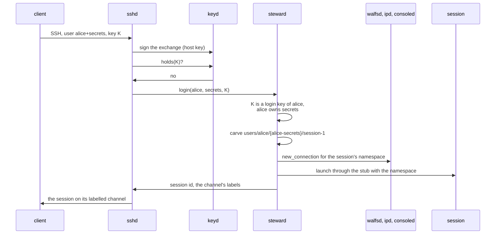
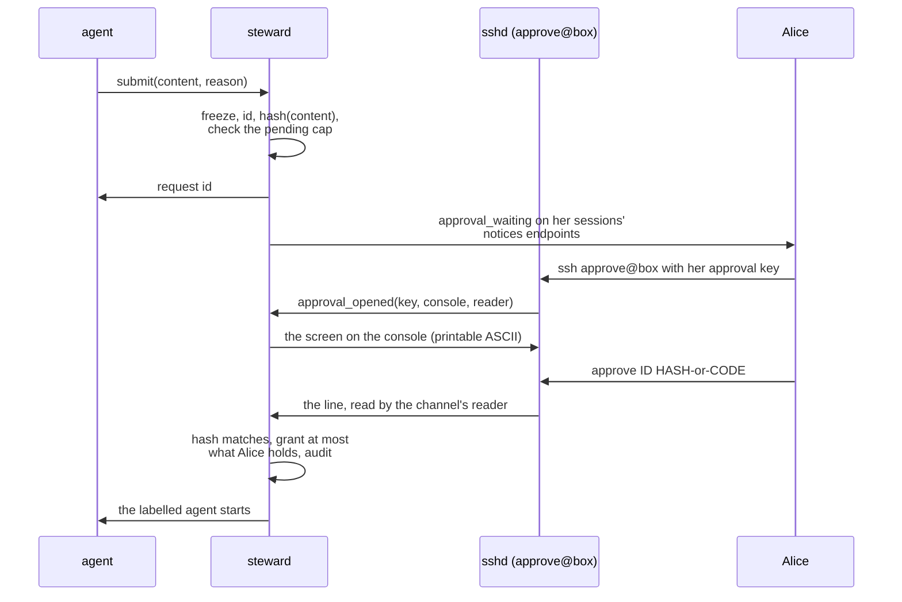
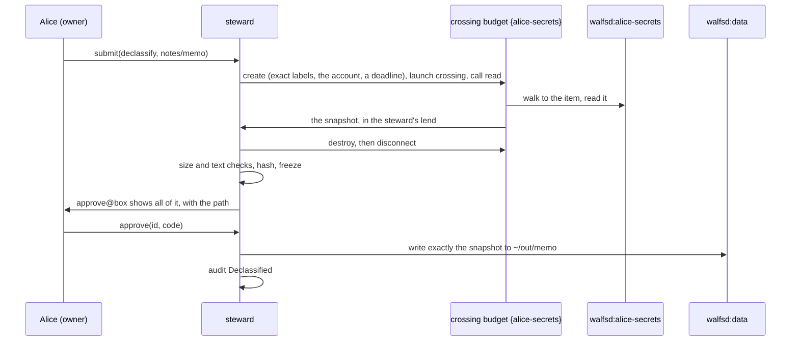

# The steward

The steward holds the system's policy about people and agents. It knows the principals,
authenticates logins that `sshd` passes it, carves every session and agent lease from the
`users` budget and launches it, runs the powerbox where a principal asks for authority it lacks,
declassifies and pushes single items across a label under an out-of-band approval, decides what a
crash blamed on a principal costs it, and keeps the audit log. It holds no keys and parses no ELF.
Its policy is one pure state machine ([the policy core](#the-policy-core)), which the model also
runs, on the executable model of the kernel.

## Purpose

The kernel enforces budgets, labels and handles; it does not know who Alice is. Something must
turn "Alice logged in with this key" into a budget with Alice's account and labels and a
namespace of fresh connections, and must decide when an agent may have more than it was given.
Putting all of that in one `system`-class server keeps the policy in one place, reviewable and
modelled, and keeps the kernel free of it. The steward parses the most untrusted input in the
system (every agent's requests), so it holds nothing it could leak: no keys, no ELF parser, no
standing labelled reader.

## Interface

### The policy core

Status: built · tested (58)

- host:redoubt-steward::a_manifest_with_a_key_in_two_roles_is_refused
- host:redoubt-steward::the_lines_read_as_the_manifest_and_write_back_the_same
- host:redoubt-steward::keyd_and_servers_are_empty_when_absent_and_sizes_is_required
- host:redoubt-steward::a_malformed_line_is_refused_with_its_number
- host:redoubt-steward::a_name_with_any_bytes_writes_back_the_same
- host:redoubt-steward::the_key_id_is_the_first_eight_bytes_of_the_key_s_sha_256_little_endian
- host:redoubt-steward::the_kept_corpus_reads_or_is_refused_without_a_panic
- host:redoubt-steward::boot_carves_a_fixed_sub_budget_per_label_set
- host:redoubt-steward::login_key
- host:redoubt-steward::owns_labels_reads_the_manifest_not_the_domains
- host:redoubt-steward::a_login_s_refusals_tell_nothing_apart
- host:redoubt-steward::context_free_holds_one_session_per_name
- host:redoubt-steward::a_session_is_carved_from_its_domain_with_a_scope_for_its_connections
- host:redoubt-steward::the_batch_steps_for_a_session
- host:redoubt-steward::approval_key
- host:redoubt-steward::caller_unlabelled
- host:redoubt-steward::lease_bounded_and_carve_lease
- host:redoubt-steward::blame_window_and_not_locked
- host:redoubt-steward::pending_cap_and_fair_share
- host:redoubt-steward::drop_requests
- host:redoubt-steward::exact_labels_and_item_fits
- host:redoubt-steward::agent_own_set
- host:redoubt-steward::reaches_and_render
- host:redoubt-steward::rendered_here_and_hash_matches
- host:redoubt-steward::a_closed_channels_id_reopened_answers_nothing_it_rendered
- host:redoubt-steward::reaches_only_requests_whose_labels_the_principal_owns
- host:redoubt-steward::a_granted_lease_starts_in_its_own_domain
- host:redoubt-steward::not_locked_keeps_a_grant_pending
- host:redoubt-steward::a_declassification_copies_out_exactly_its_snapshot
- host:redoubt-steward::a_push_writes_its_snapshot_through_a_writer_with_the_target_labels
- host:redoubt-steward::sponsor_session_and_notify_sponsor
- host:redoubt-steward::a_lease_ends_at_its_deadline_or_its_process_exit
- host:redoubt-steward::notify_reaches_only_channels_with_the_requests_labels
- host:redoubt-steward::audit_visible
- host:redoubt-steward::a_failed_start_ends_the_session
- host:redoubt-steward::an_excluded_event_makes_the_steward_exit
- host:redoubt-steward::an_event_naming_nothing_gets_one_answer
- host:redoubt-steward::the_same_events_give_the_same_effects
- host:redoubt-steward-gen::parses_tables
- host:redoubt-steward-gen::refuses_unknown_names
- host:redoubt-steward-gen::refuses_bad_rows
- host:redoubt-steward-gen::refuses_bad_machines
- host:redoubt-steward-gen::every_row_is_read_or_refused
- host:redoubt-steward-gen::fenced_code_is_not_a_table
- host:redoubt-steward-gen::link_checks_names_and_vocabulary
- host:redoubt-steward-gen::dispatch_takes_rows_in_order
- host:redoubt-steward-gen::the_tables_parse
- host:redoubt-steward-gen::generated_files_are_current
- host:redoubt-model::steward_policy
- host:redoubt-model::steward_noninterference
- host:redoubt-steward-trace::equal_outputs_pass
- host:redoubt-steward-trace::a_changed_output_line_is_caught
- host:redoubt-steward-trace::the_reference_output_splits_into_traces_and_rows
- host:redoubt-steward-trace::a_written_trace_reads_back
- host:redoubt-steward-trace::strings_round_trip
- bench:elixir-oracles
- bench:bench-elixir-oracles-broken-guard
- host:redoubt-steward-server::the_binding_table_binds_each_slot_as_the_page_says

Everything the steward decides is one pure state machine, the crate `redoubt-steward` (`no_std`,
no `unsafe`, no I/O), shared by the steward server and the model. The server is its embedder:
it turns messages and exit notices into events, carries out the effects the core returns, and
decides nothing itself.

#### One decision function

`decide(&mut Store, Event) -> Effects`. An event carries the time (`now`, the embedder's clock)
and the fresh random words the event may need for ids (R36: the embedder draws them from the
kernel's `random`, so the core holds no generator and no counter). Effects are data: budgets to
create and destroy, connections to ask for, a program to launch, an item to read or write
through a crossing budget, a reply, a notification or a rendered screen for an approval
channel, and audit records. An effect that produces something (a budget, a connection, a
process, a snapshot) names a token. One event's effects form a batch, which the embedder runs in
order, giving a later effect the result of an earlier one by its token. It stops at the first
failure, and then reports the batch as one `Done` event, with every result or the step that
failed. A machine waiting for a batch is in a state of its own, so every failure has a
transition.

Events one machine raises for another (a grant's lease, a crossing's snapshot for its request, a
lockout, a session's end for its requests) are the core's own and never a batch's steps: `decide`
runs them in the order they were raised before it returns, and drops without an answer one that
names an object already gone. An event the embedder's guarantee excludes is a steward bug, and
the server fails closed: it exits, and `init` restarts it ([below](#failure-and-restart)).

The embedder guarantees, and the core assumes, that:
- events come one at a time, and a batch's `Done` arrives before any other event about that
  object;
- each event's caller is the one the kernel stamped. The badge class decides the role (`sshd`,
  `init`, an approval channel, a session's minted badge, the steward's exit reports), and the
  embedder maps a session's badge to its session through the core's routing index;
- `now` never goes back, and the random words come from the kernel's generator.

The server's own work is transport, admission and effects, all read from the tables: it decodes
the protocol, admits by [R26 (admission fairness)](serving.md#r26-admission-fairness) except for
the events the tables mark ahead of admission (`EndLease`), runs each batch through the client
library, and signs audit records through `keyd`. Rendering, every check and every audit record
are the core's.

#### Domains

The store is partitioned by **domain**: `(account, label set)`, where the account is a
principal's (never 0) and the label set is sorted and at most `MAX_LABELS` long. System-class
callers (`sshd`, `init`, an approval channel) are roles of an event, never domains. A domain
holds:
- its fixed sub-budget ([below](#fixed-sub-budgets-per-label-set)), the one budget its sessions
  and leases are carved from;
- its sessions and leases, and the counters that number and name them (R37);
- the pending requests its sessions submitted, with their cap and fair shares;
- its blame window and lockout (R40).

Outside every domain is what the boot manifest fixes and nothing changes: principals, keys,
owned labels, the keys `keyd` holds. Then the routing index, which says where each session and
lease is and holds nothing else of a domain: it is written when one starts or ends, and read to
route an event and to address a notice. And the approval channels, which belong to a principal
across its label sets.

A handler sees one domain: it gets `&mut DomainState` for the domain of the event's caller and
no other domain's. Exactly three functions take two domains, one for each of
[R34 (confined placement)](init.md#r34-confined-placement)'s control-plane edges:
- **the request and approval path:** an approval acts on a request in the requester's domain,
  and a grant may start a lease in another domain of the same account;
- **the crossing:** declassification and push move one item between a labelled domain and the
  unlabelled domain of the same account, through a reader or writer budget;
- **lease supervision:** a sponsor ends a lease, and learns that it ended.

Only the module that holds these three can borrow two domains at once. So no other handler can
read or change a second domain: [R37 (vault non-interference)](#r37-vault-non-interference) is
kept by the type, not by review. Audit records have one constructor, which takes a domain and
stamps its account and labels, so no record can lack the labels it must be read under. An edge's
record is stamped with the labelled side's domain. So a request an unlabelled session submits for
a labelled target (a labelled agent, a push) is recorded under its target's domain from
submission on: whether it was approved depends on that domain's lockout. A labelled caller's
request for an agent names its own label set (`agent_own_set`), so its record, its lease and its
number stay in its own domain.

#### Machines

Each object is a plain `enum` with one transition table: a session, a lease, a request, a
crossing, a domain's blame and an approval channel. A request is rendered before it can be
answered: `Approve` and `Deny` are transitions only from `Rendered`, on the channel that rendered
it last. What an approval starts belongs to the machine it starts (a lease, a crossing), so
`Approved` is final and a failure after it is that machine's transition. A crossing's kind is fixed
when it opens and each kind has rows of its own: a declassification's read and a push's write go
through a budget carrying exactly the labelled side's labels; a declassification's copy out is
the steward's own write to the unlabelled volume, with no budget.

The events are `Boot` (the manifest), `Login`, `ChannelClosed`, `ApprovalOpened` and
`ApprovalClosed` from `sshd`; `StartAgent`, `Submit`, `EndLease` and `EndSession` from a session;
`Pending`, `Approve` and `Deny` from an approval channel; `Blame` from `init`; `Exited` from the
steward's exit reports (a session, a lease or a crossing budget's process); and `Done` for a
batch.

Each machine's table has the rows `| From | Event | Guard | To | Effects |`. Guards and effects are
named in the table and written by hand in the core. A generator in the style of the
[wire generator](wire.md#wire-tables-and-the-generator) writes from the tables the core's
dispatch (an exhaustive `match` on state and event) and the state diagrams on this page, both
checked in, with a drift check; with the Elixir reference it writes that reference's clause
skeletons too. No state-machine library and no macro.

##### The session

{{#include ../../libs/steward/tables/session.md:table}}
{{#include ../../libs/steward/tables/session.mermaid.md}}

##### The lease

{{#include ../../libs/steward/tables/lease.md:table}}
{{#include ../../libs/steward/tables/lease.mermaid.md}}

##### The request

{{#include ../../libs/steward/tables/request.md:table}}
{{#include ../../libs/steward/tables/request.mermaid.md}}

##### The crossing

{{#include ../../libs/steward/tables/crossing.md:table}}
{{#include ../../libs/steward/tables/crossing.mermaid.md}}

##### A domain's blame

{{#include ../../libs/steward/tables/blame.md:table}}
{{#include ../../libs/steward/tables/blame.mermaid.md}}

##### The approval channel

{{#include ../../libs/steward/tables/approval_channel.md:table}}
{{#include ../../libs/steward/tables/approval_channel.mermaid.md}}

#### Guards and effects

Each guard and each effect that carries a rule is one function, and each has a mutation in the
model that breaks it, which a property family must catch. The shipped crate carries no mutation
switch: the dispatch calls guards and effects through a table of functions, the shipped one by
default. The model swaps one entry for a broken one.

| Guard or effect | Rule | Mutation |
| --- | --- | --- |
| `login_key`, `approval_key` | a login uses only one of the principal's login keys and an approval channel only one of its approval keys; the boot manifest fixes both sets and `keyd`'s keys, and keeps all three apart ([R35 (key separation)](init.md#r35-key-separation)). The mutations widen a guard to the key an attacker could sign with: one `keyd` holds, or a login key | `PolicyLoginWithKeydKey`, `PolicyApproveWithLoginKey` |
| `owns_labels` | a vault login, a labelled agent, a declassification or a push needs the labels' owner, read from the manifest's owned labels, never from a domain's existence; a login it refuses is answered as a wrong key is ([contexts](#contexts)) | `PolicyVaultWithoutOwnership` |
| `context_free` | [R79 (one session per context)](#r79-one-session-per-context) | `PolicyContextTwice` |
| `take_over`, `detach_relay` | [R80 (one channel per context)](#r80-one-channel-per-context): a takeover only after every authentication guard; the channel taken over let go before the new one is attached; a channel's attachment id forgotten when it is let go | `PolicyTakeoverBeforeAuth`, `PolicyBothAttached`, `PolicyStaleCloseDetaches` |
| `caller_unlabelled` | a labelled session or agent starts nothing; it only submits requests | `PolicyLabelledStartsAgent` |
| `agent_own_set` | an agent request names a labelled agent: a labelled caller's, exactly its own label set, so its lease and records stay in its domain (R37); an unlabelled agent is `StartAgent`'s | `PolicyAgentOtherSet` |
| `not_locked`, `blame_window` | R40 | `PolicyNoLockout`, `PolicyBlameNoWindow` |
| `pending_cap`, `fair_share` | the pending cap per domain, a fair share per session | `PolicyNoPendingCap`, `PolicyNoFairShare` |
| `drop_requests` | a session's end drops its requests | `PolicyDeadSessionRequestsKept` |
| `lease_bounded`, `carve_lease` | R39: a lease at most `MAX_LEASE`, its budget from its domain's sub-budget, ending with it | `PolicyUnboundedLease` |
| `reaches`, `render`, `notify` | R38's screens: an approval channel reaches only its own account's requests, whose every label its principal owns; printable ASCII, capped, no labelled free text; an approval-waiting notice reaches only channels whose labels include all the request's | `PolicyShowLabelledToAll`, `PolicyRenderNotWhitelisted`, `PolicyLabelledFreeTextShown`, `PolicyNotifyLabelledToAll` |
| `rendered_here`, `hash_matches` | R38's binding | `PolicyApproveOtherChannel`, `PolicyApproveIgnoresHash` |
| `exact_labels`, `item_fits` | R42: a declassification is submitted from a session with exactly the item's labels, a push from an unlabelled session; a declassified item is at most `DECLASSIFY_MAX` bytes of printable text | `PolicyDeclassifyFromUnlabelled`, `PolicyDeclassifyUnfit` |
| `carve_crossing`, `copy_out` | R42: a reader or writer budget carries exactly the labelled side's labels; a copy out writes exactly the snapshot | `PolicyDeclassifyWithoutReader`, `PolicyDeclassifyLive` |
| `sponsor_session` | a lease is ended only from an unlabelled session of its sponsor | `PolicyEndLeaseFromVault` |
| `sponsor_of` | a sponsored principal's session is ended only from an unlabelled session of its sponsor | `PolicySponsoredEndedByAnyone` |
| `sponsor_set` | a sponsored principal logs in to its unlabelled set alone | `PolicySponsoredVaultLogin` |
| `audit_visible` | every audit read goes through it: a record is read under [R25 (the label check)](serving.md#r25-the-label-check) | `PolicyAuditUnfiltered` |

A guard that reads only an object's kind (which crossing it is, whether a request snapshots)
carries no rule, is named only in the tables, and has no mutation.

Each rule has one keeper, and its mutation breaks that keeper: a second check of the same rule
would hide the mutation. So the approval edge's `reaches`, a function of the policy table, keeps
R38's screens to their owners, and no guard repeats it.

`not_locked` guards every start in a domain, and its keeper is the login. A session's `StartAgent`
in a locked domain is reached only if time goes back: a lockout ends every session of the domain,
and none starts there again until the window has passed. The row stays, because the core takes
`now` from its embedder and does not assume that it only goes forward. It is the same guard, not a
second keeper, so it hides no mutation.

Five of the model's mutations break a rule the types or the keepers now keep, and they cannot be
written. Blame or a pending cap counted per account (`PolicyBlamePerAccount`,
`PolicyCapPerAccount`) and a session carved from another label set's sub-budget
(`PolicyCarveFromUnlabelled`) each need a second domain. A narrowing handle for a session's
budget (`PolicyNarrowToSessionBudget`) needs a budget where the effect takes only a revocation
scope, a type of its own that only a zero-limit `CreateScope` makes (R41). An approval granting
more than its approver holds (`PolicyApproverExceeds`) needs a request whose labels or asked
labels its principal does not own, and `owns_labels` refuses every one at entry and at
submission (its mutation is `PolicyVaultWithoutOwnership`), while `reaches` keeps a request to
its own principal's channels. They are retired, and this table says why. Ids drawn from a counter
(`PolicySequentialIds`) and end-lease admitted behind others (`PolicyEndLeaseAdmitted`) break the
embedder's half, and stay mutations of the model's embedder.
So does an item written by a session without exactly its labels (`PolicyWriteUp`): that check is
the volume's ([R25](serving.md#r25-the-label-check)), and no steward event.

The request binding hash is SHA-256 over the request's canonical encoding, through the box's
own `libs/sha256`, which `keyd` and `init` use too: one function with no dependencies
([tenet 5](../TENETS.md#5-dependencies-are-part-of-the-trusted-computing-base)). It is the
core's one cryptographic function, with a login key's id. It binds content and signs nothing,
so the steward still holds no key.

#### Two embedders and a reference

- **The steward server** (`servers/steward`) binds effects to the client library and the kernel:
  it runs each batch's steps in order, stopping at the first that fails, and reports the batch
  as one `Done`. Its binding table maps each `Shared` slot to a server, a root and a badge per
  domain class; a slot bound to nothing for that class is produced without a call. One function
  is the table (`own::binding`): the connections and the launch both read it. The slots, in
  order: `bootfsd` at `/boot`; the home volume's server at the home's path; the label set's
  volume's server at `/vault` (a vault session only); `ipd` at `/net`, granted the
  principal's scope (an unlabelled session only); the console at `/dev/cons` (`sshd`'s channel,
  or `consoled` for the console principal's session); and the system volume's `erofsd`. The
  child finds the first and last also under beamlet's handle names, `bootfsd` and
  `erofsd:system`, the latter named by its `endpoint=` argument. Every
  random word it hands the core has its top bit set, so every id and badge the core draws is in
  the minted range ([R27 (badge allocation)](serving.md#r27-badge-allocation)) and no session's
  badge is a root badge. It says on its console each audit record, each step that failed with the
  kernel's error, and each sub-budget's usage when it changes, before it answers the call that
  caused them; and how each process it launched ended, once, as `steward: lease NAME of
  ACCOUNT/LABELS exited CODE` (`faulted`, `was killed`), NAME the name the `lease_ended` notice
  gives the lease (`alice/agent-1`; a session's is `alice/session-2`), so the two lines
  correlate: the lease's end audit while audit records are console lines; a crossing's program
  the same way as `steward: crossing ID of ACCOUNT/LABELS exited 0`, ID the crossing's: the
  program exits once its one call is answered, or `was killed CODE` when its budget's
  destruction came first ([declassification and push](#declassification-and-push)). It
  says its own time on each `end_lease`, `start_agent` and `submit`, `steward: served submit in
  N us`, from the call's arrival to its answer, one queued console line per call, so a lease's
  launch is measured at the steward and not inferred from the gaps between its audit lines
  ([residual risks](#residual-risks)).
- **The model** binds the same crate to the kernel model, in place of its own copy of the
  policy, so the property families (P1 to P18) and the mutations attack the code that ships. The
  model's families drive events; its checks read the core's state through a read-only
  inspection API that the server does not use.
- **The Elixir reference** (`libs/steward/elixir/`, its clause skeletons generated from the same
  tables into `gen/`), `decide/2` as multi-clause functions over a `defstruct` state, runs on
  beamlet on the build host as a differential oracle, in the bench's `elixir-oracles` case
  ([the test bench](../testbench.md#elixir-oracles)). The same event traces must give equal
  states, effects and audit records. Its guards, effects, rendering and binding hash (SHA-256
  through `:crypto`) are written by hand from this page and the tables; they follow the core's
  in order and shape, so the two are not independent readings
  ([residual risks](#residual-risks)). It is a test oracle in the sense
  [tenet 3](../TENETS.md#3-rust-and-assembly-only-where-rust-cannot-reach)
  allows on the build host. It is never authoritative and never runs on the box.

#### The manifest lines

The core's view of the boot manifest is a few text lines, which `init` hands the steward as its
arguments, one line each after its entry's own ([init](init.md#starting-the-servers), step 6):
the manifest is never public, so `/boot` cannot carry it. A trace begins with the same lines.
- `principal "NAME" account=N login=[..] approval=[..] owned=[..] sets=[[..],..] top=P,N,W
  contexts=N idle=S`: one per principal, its keys by id, its owned labels and each label set by
  label ids, its unlabelled set first, its budget, and its cap of live contexts per label set and
  their idle bound in seconds ([contexts](#contexts)); `sponsor="NAME"` on a sponsored principal's
  line, the one field a line may leave out, names the principal that answers for it
  ([leases](#leases)): boot carves it no top budget (`top=0,0,0`), and its sessions are leases of
  its sponsor's. A sponsor is another principal, itself unsponsored: no chains here.
- `keyd [..]`, the ids of keys `keyd` holds; `init` writes `keyd []` (see
  [residual risks](#residual-risks)).
- `servers N`, the shared servers' slots a session connects to.
- `sizes session=P,N,W agent=.. sub_agent=.. crossing=.. cost=N [agent_quota=B]`, the budgets the
  steward carves, and the bytes of its sponsor's home a lease's root is carved with (the one
  field the line may leave out: 0 then, a root that holds nothing).

After the core's lines `init` appends the steward's own, which the server parses and the core
never sees, each naming only what `init`'s check found in the manifest:
- `label "NAME" id=N`, a label's name, for a login's label;
- `home "PRINCIPAL" handle=H path=/P quota=N`, its home at the server `init` handed the steward
  as the named handle `H`, holding at most `N` bytes, 1 or more
  ([home quotas and vaults](#home-quotas-and-vaults));
- `vault "PRINCIPAL" labels=[..] handle=H`, the labelled volume of one label set it works under
  (a set with no volume has no line);
- `net "PRINCIPAL" PREFIX:PORTS ...`, its network scope in the manifest's form, `*` for every
  port, which the steward passes to `ipd`'s `grant`.
- `console "PRINCIPAL"`, the manifest's `console`: the principal whose unlabelled session the
  steward opens on the UART;
- `confined`, alone, when the manifest sets `confined`: a labelled session's home slot binds
  nothing, and a push is the domain's way in ([declassification and
  push](#declassification-and-push); [init](init.md#the-confinement-check)).

The parser is the core's (`libs/steward/src/manifest.rs`), `no_std` and strict: each field once and
no other, `keyd`, `servers` and `sizes` at most once and `sizes` required, a number digits only.
A line it refuses is a start failure, said once on the console. `init` writes the lines with the
core's own writer, so the two cannot drift. A key's id is the first eight bytes, little-endian, of
SHA-256 over its 32 raw bytes (`hash::key_id`): `init` computes it for the lines, and the steward
for a login, so the core never sees a key. The parser is fuzzed
([tenet 6](../TENETS.md#6-tested-to-hell-and-back)).

#### The trace encoding

A trace is a text file, `libs/steward/trace/traces/*.trace`, and the crate
`redoubt-steward-trace` (host-only, outside the shipped core) reads it, runs it through the core
and checks the reference's output against the core's. Its input is the boot manifest, then one
event per line:
- the [manifest lines](#the-manifest-lines), read by the core's own parser; blank lines are
  skipped and `#` starts a comment.
- `event now=N random=[..] reply=N Kind field=value...` is one event: its time, at most the core's
  count of random words (the rest zero), the reply slot, and the event with its fields by name. An
  object is `kind@account/labels#id` (`session@1/7#101`). A string is quoted, with the escapes
  `\"`, `\\`, `\n` and `\xNN`. A `Done` carries `ok=[..]`, what each step made in order
  (`budget(N)`, `scope`, `connection`, `process(N)`, `bytes("..")` or `done`), or
  `failed=STEP,ERROR`. A `Login` without `context=` names the default context, `""`.
- `hash=shown` in an `Approve` stands for the hash the last screen of that request showed, as an
  approver copies it, so a hand-written trace names no SHA-256. Both sides substitute it alike.

The output is `boot`, then what boot fixed and carved, once (`principal`, `fixed`, `carve`,
`carve-sub` lines; what is fixed never changes, so it is not repeated). Then for each event,
`event N` and its effects in order: replies, notices, screens, audit records and forgets as
`reply`, `notice`, `screen`, `audit` and `forget` lines, then each batch as `batch OBJECT` and its
`step` lines, and `exit` if the event makes the steward exit. Then `store` and the store read
through `inspect`: each domain in the manifest's order with its objects by id, the routing index
(`route`, `id`), the approval channels, and `exited`. Each side writes its output, and the two are
compared byte for byte, so a map is written in key order on both.

The reference also writes `row MACHINE LINE` for each row it takes, the row's line in its table,
which is not compared: coverage is the reference's claim, and the core has no row hook to
confirm it ([residual risks](#residual-risks)). A trace's output
follows a line `trace NAME`, and the run ends with `done`, so a run cut short is refused.
`steward-trace check` fails on a trace whose outputs differ, naming its first differing event, the
event's input line, the first differing line from each side (the core's, then the reference's)
and the rest of that event's output from both, and goes on to the next trace. It also fails on a
trace with no events, a trace the reference did not run and a row the hand-written traces leave
untaken.

The model writes the events its steward families drive (`steward_policy` at seeds 1 to 4,
`steward_noninterference` at seed 1) as `model-*.trace`, afresh on each run, so they never drift
from the model; `check` lists the rows they never reach. `libs/steward/elixir/run-traces` runs
both sets; `--break GUARD` holds one of the reference's guards always, the negative run, which
`bench-elixir-oracles-broken-guard` requires to fail.

### Principals

Status: built · tested: bench:steward-boot, bench:steward-ssh-two-principals, host:redoubt-steward-server::each_principal_gets_a_top_budget_under_users_and_a_sub_budget_per_label_set

- A **principal** is a named, accountable identity: a way to authenticate, a set of capabilities
  (a namespace and service grants), and an audit identity. People, agents and projects are the same
  kind of principal; they differ in how they authenticate and in default policy, not in mechanism.
- Each principal's top budget carries its **account**, which the steward sets. Everything under
  it, its agents included, shares that account.
- **No root, no sudo.** Administration means holding specific capabilities over shared things.
- The principals come from the boot manifest ([init](init.md#the-boot-manifest)): each one's login
  and approval keys, budget, account, owned labels, the label sets it works under, home and
  network scope. The steward is stateless across boots.
- **Nesting.** Every principal has its own space, and its sponsor can destroy its budget. A
  **sponsored principal** (`sponsor` in the manifest) has no top budget of its own: its sessions
  are leases carved from its sponsor's unlabelled sub-budget, which the sponsor can end
  ([leases](#leases)). Principals can run their own servers and delegate into them.

### Fixed sub-budgets per label set

Status: built · tested: bench:steward-boot, bench:steward-vault-session, bench:steward-sub-budget-flood, host:redoubt-steward-server::a_vault_login_carves_from_the_vault_s_sub_budget_and_has_no_network

At boot the steward splits each principal's top budget into fixed sub-budgets, one per label set
the manifest names for it (`users/alice/{}`, `users/alice/{alice-secrets}`), each an equal share
of the principal's top budget, less a budget's own cost. Every session and lease of one
(principal, label set) is carved from its own sub-budget. So a vault session's leases never
change what the unlabelled side can carve: carving under one shared top budget would let the
unlabelled side read the vault's activity in its free limits
([R37 (vault non-interference)](#r37-vault-non-interference)). The model checks that every
session and lease is carved from its label set's sub-budget (its P1). A carve from another label
set's sub-budget would need a second domain, which no handler can borrow, so it has no mutation
([guards and effects](#guards-and-effects)). Sizes per label set may return with run-time
principals in M6 (persist, install, share), if evidence asks for them.

The steward carves at its start: for each principal a top budget under `users` with its account,
and under it a sub-budget per label set with that set's labels; a carve the kernel refuses is a
start failure, and the box has no users.

### Home quotas and vaults

Status: built · tested: bench:steward-home-quota, bench:init-refuses-overcommit, host:redoubt-fileserver::sessions_minted_through_one_carve_share_its_quota_across_a_restart, host:redoubt-steward-server::a_malformed_line_is_refused, host:redoubt-init::home_quotas_are_checked_against_their_volume, host:redoubt-init::a_vault_is_one_principals, host:redoubt-init::no_home_is_another_s_or_inside_it

- **A home's quota is the principal's, whatever its sessions.** The manifest gives each home a
  byte quota (`home_quota`, [init](init.md#home-quotas)), which reaches the steward on its `home`
  line. The first time a session of the principal needs its home, the steward mints one
  connection at the home's server, rooted at the home, with that quota, and keeps it for its own
  life; every session's home is minted through it with no quota of its own, at its root, so they
  all share the one quota: two sessions, or a session and the console session, stop together at
  it, and so do a principal's named contexts. A session's connection is disconnected through the
  kept one when the session ends. A lease's root, the home's `project` directory, is minted
  through the kept one too, but below the home, with the manifest's `agent_quota` bytes carved
  from the home's quota for the lease's life ([leases](#leases)). A write past the quota is the server's `enospc`
  ([walfsd](walfsd.md#quotas)); the principal's other homes' room, and every other principal's,
  is untouched.
- **A restart re-carves.** A dead steward's kept connections go with it: `init` disconnects the
  fresh connection it made for the steward at each server, and every connection minted under it
  with it ([failure and restart](#failure-and-restart)). The restarted steward carves each home
  again when it is next needed, and the server counts what the home already holds against the new
  carve, so what was written counts once.
- **The quotas fit their volume.** `init` refuses a manifest whose homes on one volume ask for more
  than the bytes it gives, or in which one principal's home is another's or inside it, so the
  steward can carve every principal's home at once, each its own root; the volume's
  server refuses a carve its room cannot hold all the same, and a session then has no home.
- **A vault is its labelled volume, with no quota of its own.** A vault session's slot is minted
  at the labelled volume's own root, which carves nothing: it is bounded by the volume's room. A
  labelled volume is one principal's: `init` refuses a manifest in which two principals' label
  sets name it (a label set need not be owned, so the manifest alone could otherwise share one),
  as principals are kept apart.

### Authentication and sessions

Status: built · partly tested: a session's badge sending `login` is refused in a host test only (a session runs only beamlet) · tested (10)

- bench:userland-boot
- bench:steward-ssh-two-principals
- bench:steward-vault-session
- bench:steward-login-refused
- bench:steward-session-ends
- host:redoubt-steward-server::a_login_runs_the_session_batch_and_answers_the_session
- host:redoubt-steward-server::a_refused_login_makes_nothing
- host:redoubt-steward-server::a_mint_the_server_does_not_take_in_time_fails_the_step_and_the_next_caller_is_served
- host:redoubt-steward-server::the_console_session_opens_at_the_start_and_again_when_it_ends
- host:redoubt-steward-server::sessions_coming_and_going_reuse_the_watchers

- **Login.** `sshd` runs SSH and asks the steward whose key a login used. The steward accepts only
  one of that principal's login keys, never a key `keyd` holds, and `sshd` itself refuses any key
  `keyd` holds ([keyd](keyd.md)). The model checks both (its P2; `PolicyLoginWithKeydKey`).
  A login carries two connections to its channel's console: the steward keeps the first and
  hands the second to the context's relay ([contexts](#contexts)). When the channel is let go,
  the steward tells the first `ended`, then releases it; only that one ends the channel
  ([sshd](sshd.md#sessions-over-ssh)). A login whose server does not answer one of the batch's
  calls within `SERVER_US` is refused, and the person logs in again
  ([residual risks](#residual-risks)).
- **A session** is processes started with capabilities derived from the principal's set, never
  more. The steward carves the session budget from the right sub-budget, with the principal's
  account and the session's labels, gives it a namespace of fresh connections it asked each server
  for ([init](init.md#fresh-connections-per-child)), and launches it through the loader stub,
  streaming the session's image from `bootfsd` through a 16-page lend, the most a call may lend,
  so the console session's VM is running within a second of the steward's start
  ([beamlet on Redoubt](../userland/beamlet.md#beamlet-on-redoubt)). Its arguments tell it what
  it is (`own::session_args`): `principal=NAME`, `label=NAME:ID` for each label of its set,
  `context=NAME` for a named context, none for the default context or the console's session, and
  `home=/PATH` where slot 1 binds the principal's home, none for a principal with no `home` line
  ([sessions](../userland/sessions.md#what-a-session-is-told)); they are the steward's word to the
  session and grant nothing. It tells the VM `schedulers=2`, two scheduler threads in the session's
  process and budget: the count is the image's choice, since the kernel does not say how many harts
  there are, and a call that does is a later package's if an image ever needs to follow the machine
  ([beamlet](../userland/beamlet.md#beamlet-on-redoubt)). The VM's heap cap is its share less what
  the two schedulers' stacks and thread pages, its locks' endpoints and its process's page take,
  44 pages ([budgets](../kernel/budgets.md#the-tree-from-the-boot-manifest)). Each
  session's process has an exit endpoint of its own, which a watcher thread of the steward's waits
  on and reports on the steward's endpoint when the process ends. A thread's stack is never given
  back, so a watcher that has reported waits for the next session, and a new one starts only when
  every watcher is watching: there are never more watchers than sessions alive at once.
- **Normal sessions are unlabelled** (`ssh alice@box`): full network and every tool; they cannot
  read labelled volumes.
- **A vault session carries exactly one label.** `ssh alice+secrets@box` opens a session labelled
  `{alice-secrets}`, only if the person who authenticated owns that label. It reads and writes its
  labelled volume; outside a confined deployment it may read, never write, unlabelled volumes, which
  is how data enters the vault. It reaches no external sink, and its output reaches only its own SSH
  channel, which the steward opened for the label's owner. The model checks the ownership rule
  (`PolicyVaultWithoutOwnership`).
- **A labelled session starts nothing.** It can only submit requests to the steward; everything it
  asks for is started, if at all, by the steward (its P8; `PolicyLabelledStartsAgent`).
- **Every id is unpredictable.** Session, request and connection ids are random 64-bit words from
  a keyed generator, never a counter, which would tell every principal how many the others made
  ([R36 (unpredictable ids)](#r36-unpredictable-ids)).
- **The console is one principal's session.** The manifest's `console` names a principal; at
  boot the steward opens that principal's unlabelled session on the UART console (`consoled`'s
  connection at `/dev/cons`) and reopens it when it ends. The console's authority is that
  principal's, stated in the manifest, never an unnamed one: physical access to the box is
  already outside the threat model ([the tenets](../TENETS.md#threat-model)), so the field
  records who the cable is, it does not grant more. A manifest without `console` starts no
  console session; one naming no principal is refused by `init` at the manifest check, so the
  steward never sees a bad name. Reopening is the server's decision, not the core's: when the core
  forgets the console session, the server opens a new one through the core's `Console` event, and
  a console session that cannot start is said once, not retried.
- **Defaults.** The steward mounts known-sensitive places (`~/.ssh`, credential directories) from
  the principal's labelled volume.

*Figure: a vault login.*

### Contexts

Status: built · tested: bench:steward-context-login, bench:steward-login-refused, bench:steward-session-ends, bench:steward-context-cap, bench:steward-three-contexts, bench:steward-context-idle, bench:shell-contexts, bench:steward-restart-context, bench:steward-login-timing, host:redoubt-steward::a_login_s_refusals_tell_nothing_apart, host:redoubt-steward::the_cap_refuses_a_new_context_and_keeps_the_oldest, host:redoubt-steward::idle_ends_a_detached_context_only, host:redoubt-steward-server::a_login_past_the_cap_is_refused_and_makes_nothing, host:redoubt-steward-server::a_session_lists_detaches_and_ends_its_own_domain_s_contexts, host:redoubt-steward::context_free_holds_one_session_per_name, host:redoubt-steward::a_context_is_attached_to_one_channel_at_a_time, host:redoubt-steward-server::a_refused_login_makes_nothing, host:redoubt-steward-server::a_login_to_an_attached_context_takes_it_over, host:redoubt-steward-server::a_takeover_from_a_stalled_channel_still_takes_it_over, host:redoubt-steward-server::closing_the_channel_detaches_the_context_and_a_login_reattaches, host:redoubt-steward-server::sshd_gone_detaches_every_attached_context, host:redoubt-init::principal_and_label_names_hold_no_separator_and_none_is_reserved

A login's session is a **context** of its principal: `ssh alice@box` the default one, whose name
is empty, `ssh alice.work@box` the context `work` ([sessions](../userland/sessions.md#contexts)).
`sshd` splits the user name and sends each part; the steward trusts none of its parse.
- **Names.** A principal's, a label's and a context's name is 1 to 64 bytes of `[a-z0-9_-]`,
  starting with a letter (`manifest::name`). `init` holds principals and labels to it and
  refuses a principal named `approve`, the approval terminal's user name; the steward holds a
  login's context to it.
- **The key first, then the rest.** A login's key is checked against the principal alone
  (`login_key`); the label set and the context are looked at only after it, and each is a table
  lookup. A key that is not the principal's, a principal the manifest does not name, a label the
  manifest does not hold or the principal does not own, and a context that is not a name are all
  refused `bad_key`, so a login cannot tell them apart by the answer. The model checks that every
  such login gets that answer (its P17). The answers are uniform in content, not in time: an
  unknown principal or label set is refused before any machine runs, and a wrong key for a known
  principal runs the blame and session machines before `login_key` refuses it; nothing is counted
  ([R40](#r40-blame-by-label-set) counts server crashes). The difference lies inside one steward
  call, and SSH's exchange hides it: `steward-login-timing` times thirty refused logins at the
  client, ten of each kind, and their medians differ by less than their spread
  ([residual risks](#residual-risks)).
- **Identity.** A context is (account, label set, name): its sessions are numbered and carved in
  its domain, as every session is, so the same name in another label set is another context, and
  nothing about it crosses the label sets ([R37](#r37-vault-non-interference)).
- **One session at a time.** A context has at most one session ([R79](#r79-one-session-per-context)).
  A login naming a context whose session is still starting is refused `in_use`; one naming a
  context that runs reaches that session, as below. The console's session is no context. The
  audit record of a login carries its context, and each later attach is recorded `Attached`
  with its key, the client's address and whether it took the context over.
- **A context outlives its channel.** Its VM's `/dev/cons` is served by a console relay,
  [`consrelay`](consrelay.md), that the steward launches in the session's budget beside the VM
  and attaches to one SSH channel at a time ([R80](#r80-one-channel-per-context)). The session's
  budget holds 128 pages for it, and the VM is told the rest as its startup block's
  `budget_pages` and capped there
  ([budgets](../kernel/budgets.md#the-tree-from-the-boot-manifest),
  [init](init.md#the-startup-block)). Closing that
  channel detaches the context: the relay lets the channel go, the steward gives its console back
  (`sshd` closes the channel with status 0), and the VM runs on, its output kept by the relay.
  `exit`, a VM that ends, and the steward's other ends still end the session.
- **Reattach and takeover.** A login to a detached context attaches the new channel, which is
  told `[context NAME: reattached]` before the kept output. A login to an attached context takes
  it over, only after every authentication guard has passed: the old channel is told
  `[context NAME taken over from ADDRESS at up XhYm]` and ended, and the new one is told
  `[context NAME: reattached; taken over from OLD-ADDRESS]`. The addresses are the clients',
  which `sshd` reads from `ipd`'s `/tcp/N/remote`; the steward builds both notes, so the relay
  writes only text it was given. Each attach answers the login with a fresh attachment id, the
  name `sshd` gives the channel's close: a close naming an id let go names nothing and changes
  nothing. A takeover from a channel that has stopped reading still takes the context over, and
  that channel may close untold: the relay gives up on the note after 150 ms, and a relay's
  `detach` that runs past its 1 s bound is counted as done, since the relay lets the channel go
  as it takes the call and only the old channel's note was late
  ([consrelay](consrelay.md#the-consrelay-protocol)).
- **`sshd`'s end detaches every context.** When `sshd`'s `watch` call ends, every channel has
  gone with it, so the steward detaches each attached context, and the next login reattaches.
- **A cap per label set** ([R82](#r82-the-context-cap)). A principal's manifest line carries
  `contexts=N`: at most N live sessions in each of its label sets, attached or detached, the
  console's session counted where it runs, since it holds a session's budget as a context does.
  `init` writes the manifest's `contexts.max`, or by default what one label set's share holds:
  the share's pages, less a budget's own cost, over a session's pages, or its processes over a
  session's, whichever is fewer, and at most 16 ([init](init.md#contexts)); for the console's
  principal `init` refuses a `max` below 2, which would leave it no SSH context. The image's
  shares each hold two sessions, so alice has one SSH context beside the console in her
  unlabelled set and two in her vault's, and bob and agent two each. A login that would make a context past the
  cap is refused `cap` by the guard `under_cap`, after `login_key`, `owns_labels`, `not_locked`
  and the context check, and before anything is carved; no context is evicted for it. A login
  that reaches a live context, a reattach or a takeover, is never capped. At the client it is the
  same failed authentication as every other refusal; `sshd` names the code on its console line
  alone ([sshd](sshd.md#sessions-over-ssh)).
- **Idle contexts end** ([R83](#r83-idle-contexts-end)). The line's `idle=S` bounds how long a
  context stays detached: `init` writes the manifest's `contexts.idle_secs`, 60 to 604,800, or by
  default a day. A detach that finds the context's clock clear starts it, and an attach clears it,
  so an attached context never ends on it, however old its last detach. The steward runs the
  timer itself, since a budget's kernel deadline cannot be cleared on a reattach: its receive
  waits no longer than the next bound (`store::next_idle`), and the event `Idle` then ends each
  detached context past its bound through `Ending`, its budget, relay and kept output with it,
  recorded `IdleEnded` with the seconds it was idle. The image keeps the day; a production image
  sets hours, and the 60 s floor is for the bench's case.
- **From the session.** A session's own `steward` connection, the minted badge every session
  holds, carries three operations whose domain is the kernel-stamped one of that badge, never a
  claim: `contexts` lists the domain's live contexts, one line each of the name (empty for the
  default context), `attached` or `detached`, and the seconds since its last attach or detach,
  with no client address; `detach` lets the caller's own channel go, as its close would, and is
  `unknown` for a session that is no context; `end_context` ends the domain's context of that
  name as `end_session` ends a session, the caller's own included, which is `exit`. A name
  outside the caller's domain, another label set's or another principal's, is `unknown`, the
  answer a name nobody holds gets ([R37](#r37-vault-non-interference)). The shell's
  `contexts()`, `detach()` and `end_context(name)` call them
  ([the shell](../userland/shell.md#session-commands)).
- **Contexts end with the steward.** A steward that dies takes every context with it: `init`
  reaps `users` ([failure and restart](#failure-and-restart)), `sshd` ends each attached channel,
  and the new steward starts on an empty table with fresh random ids, so a name never reattaches
  to anything after a restart: the next login makes a new context. That is the rule for M2 (usable shell).
  Re-adopting contexts across a restart needs a store that outlives the steward and a kernel
  lookup of its child budgets, and is planned with [M6 (persist, install, share)](../plan/m6-persist.md).

### The steward's protocol

Status: built · tested: bench:steward-login-refused, host:redoubt-steward-server::every_operation_on_another_badge_class_is_malformed, host:redoubt-steward-server::closing_the_channel_detaches_the_context_and_a_login_reattaches

The steward serves one typed protocol, its table `libs/wire/tables/steward.md`, included by this
page. Its sessions' operation is `login` (from `sshd`); the operations for leases, approvals and
crash blame are below ([the lease and approval operations](#the-lease-and-approval-operations)).

**Each operation is accepted only through the badge class it belongs to.** The steward gives a
root badge per caller role (`sshd` 1, a `handed` badge in the manifest; `init` 3, which `init`
mints for itself and the manifest check hands to nobody; the approval channel's, 2, the steward's
own, a send right it mints on its endpoint for each channel's reader, held by nobody else), and
sessions get minted badges. An operation on any other badge is malformed, the same answer as an
unknown one, so a session cannot send `login`, `approve` or `blame`.

- **`login`** carries the principal's name, the label's name (empty for an unlabelled session),
  the context's name (empty for the default one), the raw key and the channel's console
  connection, which `sshd` made for the session and which becomes its `/dev/cons`. The steward
  derives the key's id ([the manifest lines](#the-manifest-lines)), then checks the label's name
  against the manifest's; a name the manifest does not hold is `bad_key`, as every refusal before
  the session is but a live context's `in_use` ([contexts](#contexts)). The reply is the session's
  id, its name and the channel's labels.
- **`channel_closed`** ends the session the channel carried.
- **`start_agent`** and **`end_lease`**, from a session's badge, are the lease operations
  ([leases](#leases)); **`submit`**, from a session's or an agent's, **`approval_opened`** and
  **`approval_closed`** from `sshd`, and **`pending`**, **`approve`** and **`deny`** on the
  approval channel's badge are the powerbox's ([the powerbox and
  approvals](#the-powerbox-and-approvals)); **`lease_ended`** and **`approval_waiting`** are the
  steward's own sends to a session's `notices` endpoint, never calls: on any badge each is
  malformed.
- **`blame`**, from `init`'s root badge alone, is [crash blame](#crash-blame): the account and
  labels the exit notice named, counted by the core, and answered as it arrives whatever it
  counted toward.
- **`reconnected`**, from `init`'s root badge alone, carries the new connection at a restarted
  shared server, and **`rebind`**, from a session's badge, answers the slot's connection again
  with the path it is bound at; **`server_restarted`** is the steward's send to a session's
  `notices` endpoint, never a call ([failure and restart](#failure-and-restart)).
- A `submit` of a declassification (kind 2) names its item by `what`, a path in the vault; one
  of a push (kind 3) names its source and target by `what`, the source's path in the submitter's
  home, a newline, the target's path in the vault; `item` and `source` on the wire are ignored,
  the server drawing the ids the core hashes ([declassification and
  push](#declassification-and-push)).

The table: [libs/wire/tables/steward.md](../../libs/wire/tables/steward.md).

{{#include ../../libs/wire/tables/steward.md:tables}}

### The lease and approval operations

Status: built · partly tested: `start_agent`, `end_lease`, `submit` and the approval channel's operations run on the machine, `blame` on the host · tested: bench:steward-end-lease, bench:steward-approve-box, bench:steward-declassify, bench:steward-push, host:redoubt-steward-server::start_agent_runs_the_lease_batch_and_answers_the_lease, host:redoubt-steward-server::end_lease_from_the_sponsor_destroys_the_lease_and_tells_her_sessions, host:redoubt-steward-server::an_approval_channel_opens_on_the_approval_key_alone, host:redoubt-steward-server::every_operation_on_another_badge_class_is_malformed, host:redoubt-steward-server::three_blames_in_the_window_lock_the_domain_out_until_the_window_passes

The steward's protocol adds `start_agent(lease: u64)` (from an unlabelled session, answered with
the lease's id and name once its batch is done) and `end_lease(lease: u64)` (from the sponsor,
answered at once: the loop never parks it, `protocol::ahead`), `submit` (from sessions and
agents), `approve` and `deny` (from the approval channel), and `blame(account: u64, labels:
bytes, server: string)` (from `init`, [init](init.md#restarts-and-reboots)), each accepted only
through its badge class, as above; and `lease_ended(lease: u64, name: string)`, the steward's
send to a session ([leases](#leases)). A shared server's restart adds `reconnected(server:
string, connection: handle)` from `init`, `rebind(slot: u16)` from a session, answered `at:
string, connection: handle`, and the steward's send `server_restarted(server: string, slot:
u16)` ([failure and restart](#failure-and-restart)).

### Leases

Status: built · partly tested: a lease's roots are its sponsor's `~/project` and the system volume (the task-scoped grants and `gatewayd` are later) · tested: bench:steward-lease-ends, bench:steward-end-lease, bench:steward-sub-agent-dies-with-agent, bench:agent-login, bench:steward-agent-escape, bench:steward-lease-cut, bench:steward-agent-flood, host:redoubt-steward-server::start_agent_runs_the_lease_batch_and_answers_the_lease, host:redoubt-steward-server::end_lease_from_the_sponsor_destroys_the_lease_and_tells_her_sessions, host:redoubt-steward-server::a_leases_deadline_ends_it_without_a_failed_step, host:redoubt-steward-server::a_leases_index_recycled_for_a_new_budget_before_its_notice_is_not_destroyed_as_it, host:redoubt-steward-server::a_leases_index_recycled_for_a_connection_fails_no_step, host:redoubt-steward-server::an_end_lease_after_the_deadline_makes_no_destroy_by_the_revoked_handle, host:redoubt-steward-server::a_login_as_the_sponsored_principal_is_a_lease_of_its_sponsors, host:redoubt-steward::a_sponsored_principals_session_is_a_lease_of_its_sponsors, host:redoubt-steward::sponsor_session_and_notify_sponsor

An agent is its own principal, never an impersonation, with an accountable **sponsor**: a person,
or an agent with a person at the top of the chain.

- **`start_agent`** from an unlabelled session's badge (a lease's badge is told `unknown`: a
  lease is not a session, and a lease nested in a lease is a later package) is the core's lease
  batch: the lease's
  budget from the sponsor's unlabelled sub-budget with the manifest's `agent` size and the
  deadline asked for, a scope, the steward's badge on it, a connection per slot of the binding
  table for a lease (`/boot`, the sponsor's home's `project` directory at `/project`, minted
  through the home's one carve with the manifest's `agent_quota` bytes carved from the home's
  quota and given back at the lease's end, since a root below the home with no quota of its own
  holds nothing ([walfsd](walfsd.md#quotas)); a `project` holding more than that quota refuses
  the mint, the step fails and `start_agent` answers `failed`; and the system volume: no vault,
  no network, no console), and beamlet
  launched on the agent's module, `Redoubt.Agents.Echo` in this image, told `principal=` the
  sponsor and `home=/project`; its process has an exit endpoint the steward watches as a
  session's. The reply names the lease (`agent-1`, numbered per domain).
- **A sponsored principal** (the image's `agent`, `sponsor: "alice"` in the manifest) has no
  top budget: a login as it runs the session machine as any login does, but its session's budget
  is carved from the sponsor's unlabelled sub-budget with a deadline of `MAX_LEASE`, so it is a
  lease of the sponsor's: `end_lease` with the session's id ends it, and its every end tells the
  sponsor. It stays its own principal: its records and routes are its own domain's, its reply
  `session-N`, and a login of its in a labelled set is refused (`labelled`): its vault work goes
  through `submit` and an approval, never a login. The harness that drives it (the machine
  mode, a compile on the box) runs inside the lease unchanged.
- **Each path tells the sponsor:** every unlabelled session of the sponsor receives one
  `lease_ended` send on the `notices` endpoint it was launched with (the receive right is the
  named handle `notices` in its startup block, which the shell serves; the steward keeps the send
  right and closes it with the session), naming the lease as `<principal>/<name>`
  (`alice/agent-3`, `agent/session-7`) and never why; the shell prints `[lease NAME ended]`. A
  session whose VM does not take the send in the steward's bound misses it, and the steward is
  not held: the core forgets a notice no session can take. Leases ending together are told one
  send at a time, each taken at once by beamlet's serve thread, which queues it for the VM and
  takes the next ([beamlet](../userland/beamlet.md#the-forwards-queue)), so the last of a burst
  is late by the steward's own work per exit, not by the VM's take, and none is missed while the
  queue has room, a full queue holding the thread until the VM's poll
  ([failure and restart](#failure-and-restart)). The same endpoint carries
  `server_restarted` ([failure and restart](#failure-and-restart)).
- **A lease the kernel's deadline took** reaches the steward as its process's exit notice with
  the budget already gone and the steward's handle to it revoked, its table index free for the
  next handle the steward installs: the core's `DestroyBudget` on it is the end asked for, done
  already by the kernel, and the steward never makes it by that handle. The steward keeps each
  budget with the deadline it minted it with, reads the clock right before any destroy, and
  makes none once the deadline has passed: the kernel destroys a budget at the first entry at or
  after its deadline, before anything else, and never before
  ([deadlines](../userland/agents.md#a-leases-end-is-the-kernels)), nothing but the deadline revokes a
  budget handle the steward holds, and no reply the steward's threads take carries a handle (the
  cleanup thread's disconnect and ended, the reader threads' calls at consoled), so no handle is
  installed in its table between that read and the call and none can take the index; a reply
  that one day carries a handle rechecks this argument. Before this, the destroy was made and its
  `BadHandle` tolerated on a lease whose process was gone, which held only while deadlines came
  one at a time: several leases expiring together (seen when `steward-latency`'s deadline
  leases overlapped, before they ran one at a time) recycle the freed index before the notice
  is served, and a destroy by it found another kind of
  object (`WrongObject`, a failed step) or would have destroyed another lease's budget with no
  error. An `end_lease` served after the deadline but before the notice makes no destroy either;
  one on a live lease destroys it as before, and a handle that answers `BadHandle` before its
  deadline is a handle the steward lost: a failed step.
- **A principal's live leases are bounded by its share.** Its leases and its sessions of one
  label set are carved from that set's fixed sub-budget
  ([fixed sub-budgets](#fixed-sub-budgets-per-label-set)), and the kernel's carve refuses past
  it ([R7 (carving)](../kernel/budgets.md#r7-carving)); and an unlabelled lease's root is
  `project`, minted below the home with `sizes.agent.quota` carved from the home's quota, which
  its server refuses past ([walfsd](walfsd.md#quotas); a labelled lease's root is its vault,
  no quota carve, [agents](../userland/agents.md#leases)). So a principal holds at most what
  its unlabelled share holds in `agent` budgets, by pages, processes and weight, and what its
  home's quota holds in `agent` quotas, the smallest:
  `min(share_pages / sizes.agent.pages, share_processes / sizes.agent.processes, share_weight /
  sizes.agent.weight, home_quota / sizes.agent.quota)`, the share an equal part of its budget
  per label set, less a budget's own cost, as `init` derives the context cap
  ([R82](#r82-the-context-cap)); a sponsored principal's is its sponsor's. It is an upper bound:
  a lease is refused by whichever carve runs out first, the kernel's or the server's, the
  sessions carved from the same share only lower what is left for leases, and a sponsored
  principal's sessions are leases of that share. The
  image's alice: 81,920 pages over two label sets, less one, is 40,959, over 5,248 is 7; 64
  processes over two, over 2, is 16; weight 1,000 over two, over 50, is 10; her home's
  8,388,608 bytes over a lease's 1,048,576 is 8: 7. Bob, with one
  set: 32,767 over 5,248 is 6; 20 over 2 is 10; 500 over 50 is 10; 8 by his home: 6. The steward keeps no such
  count and the manifest names none; the shared servers' per-account caps take the term, the
  bench deriving it from every manifest in the tree
  ([serving](serving.md#admit); `the_servers_admit_what_a_manifest_lets_one_account_hold`).

- **An agent's budget sits under its sponsor's**, so it shares the sponsor's account: it is
  carved from the sponsor's fixed sub-budget for the lease's label set, never from a session's
  budget. So a lease outlives the login session that started it, and ends only by its sponsor,
  its deadline or blame. Its requests
  count against the sponsor's admission for its label set, with a fair share per badge inside
  ([R26 (admission fairness)](serving.md#r26-admission-fairness)), so an agent cannot lock its
  sponsor out.
- **A lease is task-scoped**: "read `~/project`, write `~/project/out`, the `model` gateway, 2
  hours, 256 MB, 4 processes, weight 20". An agent never holds a socket or a name rule: it reaches
  outside the box only through `gatewayd` capabilities ([gatewayd](gatewayd.md)). Its budget has a
  deadline ([budgets](../kernel/budgets.md)) at most `MAX_LEASE` (24 hours) away. The steward
  refuses a longer lease rather than shortening it silently; the kernel knows only deadlines, not
  leases.
- **Delegation only narrows.** An agent may start sub-agents as budgets inside its own budget. It
  holds only its own budget handle, so it cannot create siblings, and its lease's end destroys its
  sub-agents with it, whatever their own deadlines. A new durable principal, or a budget with more
  labels than its parent, needs the steward and an approval. An agent request asks for a labelled
  agent: from a labelled session, in exactly its own label set; from an unlabelled session, in a
  label set its principal owns. An unlabelled agent is started with `StartAgent`, never through an
  approval.
- **Ending a lease is always accepted from the sponsor**, ahead of admission: the steward answers
  it straight from its receive loop ([serving](serving.md#admit)). The sponsor ends it from any of
  its unlabelled sessions. A vault session cannot, since ending a lease it does not share labels
  with would be a flow out of the vault.
- **The sponsor learns that a lease ended**, however it ended: the steward notifies the sponsor's
  unlabelled sessions through the lease-supervision edge, naming the lease and not why it ended.
- **Narrowing is a revocation scope.** To give a server a way to narrow a session's or lease's
  connections, the steward passes it a revocation scope made for that purpose, never a budget
  that holds processes, which would let a compromised server end every session
  ([R41 (narrowing by revocation scope)](#r41-narrowing-by-revocation-scope)).
- **An agent holds no credentials.** It uses keys through `keyd` and, from
  M5 (self-hosted development), models through `gatewayd`. Until M6 (persist, install, share),
  which brings keys in leases, no session or lease holds a `keyd` grant, since `keyd`'s purposes
  are the host key and audit signing ([keyd](keyd.md)).
- **Assume every agent is compromised** by something it read: it can do what its capabilities
  allow until its lease ends, and nothing more.
- **Each agent runs in its own VM**; sub-agents with different authority are separate VMs.

The model checks leases and their end (its P9 and P13; `PolicyUnboundedLease`,
`PolicyEndLeaseAdmitted`, `PolicyEndLeaseFromVault`, `PolicyNoFairShare`), the sponsored principal (its P1 and P13; `PolicySponsoredVaultLogin`,
`PolicySponsoredEndedByAnyone`) and the lease lifecycle ([R39 (leases end)](#r39-leases-end)):
the lease machine's, whose table and generated diagram are [above](#the-lease), and the session
machine's `EndLease` rows.

Residuals: a lease's "read `~/project`" root is writable, since no server takes a read-only
connection yet; a sponsor whose sessions all missed the notice has no `leases` listing to ask
(later, with the powerbox); the lease's connections end by the launcher's disconnect at its end
until [R41](#r41-narrowing-by-revocation-scope)'s scope lands.

### The powerbox and approvals

Status: built · partly tested: a labelled agent's request, a note, a declassification and a push are submitted, rendered, approved and denied on the machine · tested: bench:steward-approve-box, bench:steward-declassify, bench:steward-push, bench:steward-screen-inert, bench:steward-pending-cap, bench:steward-vault-note, host:redoubt-steward-server::a_request_is_rendered_bound_to_its_screen_and_its_approval_starts_the_labelled_agent, host:redoubt-steward-server::notes_are_rendered_by_their_requesters_labels_and_a_dead_sessions_requests_are_gone, host:redoubt-steward-server::an_approval_channel_opens_on_the_approval_key_alone, host:redoubt-steward-server::the_three_commands_parse, host:redoubt-steward-server::the_fuzz_corpus_still_passes, mutation:PolicyApproveIgnoresHash, mutation:PolicyApproveWithLoginKey, mutation:PolicyNoPendingCap

The **powerbox** grants authority a principal lacks and confirms a principal's own high-stakes
steps: an agent asking its sponsor, a principal asking the holder of a shared resource, a new
trusted key, a declassification. Most things need none.

- **Out of band.** An approval happens only where the steward alone talks to the terminal:
  `ssh approve@box`. Sessions and agents only notify that an approval is waiting. The requester can
  never influence the approval channel.
- **The approval key is the person's own.** Keys that authenticate a person to the box stay on the
  person's machine and never live in `keyd` ([R35 (key separation)](init.md#r35-key-separation));
  the steward refuses to enrol one key in both roles; a session's network scope never includes the
  box's own addresses. Otherwise a hijacked session could log in to `approve@box` over loopback,
  signing with `keyd`, and approve itself.
- **Rendering.** The steward renders from the structured request: the requester's kind (agent,
  session) and steward-assigned name (`agent-7`) beside its principal, what, where, how long, and
  the label consequences. Every rendered field is printable ASCII (0x20 to 0x7E; anything else is
  escaped), with no control character (U+0000 to U+001F, U+007F to U+009F) and so no ESC, so no
  terminal escape can repaint the approval screen and no bidi or format character (U+202E, U+2066,
  U+200B) can disguise it. A requester-supplied field is at most `FIELD_CAP` (64) characters,
  counted as Unicode scalar values, and is shown marked as the requester's text. An unlabelled
  requester's free-text reason is quoted, escaped and marked untrusted. A **labelled** requester's
  request shows only text the steward generates (kind, target, size): its free text would be a
  channel out of the vault.
- **Binding.** Each request has a random 64-bit id and a hash of its exact content; approving
  names both. The request is frozen until answered, and any change makes it a new request.
- **Limits and labels.** Each (account, label set) has a cap on pending requests, and a session
  holds at most a fair share of it; a dead session's requests are dropped. A labelled request is
  shown only to principals owning every label it carries, and otherwise refused at submission. Its
  "approval waiting" notification reaches only channels whose labels include all of the request's,
  and `approve@box`. The share is the cap divided among the domain's live sessions and leases, at
  least one: beside Alice's console and SSH sessions her agent submits one request and its second
  is `cap`, whatever the domain has left.
- **An approval grants no more than the approver holds.** A request reaches only its own
  principal's approval channels, and that principal owns every label the request carries or asks
  for, checked when it entered and when it was submitted. A project's requests, which several
  members may approve from M6 (persist, install, share), bring a check of their own.

*Figure: an agent's request approved out of band.*

**The channel, as built.** `sshd` recognises the user name `approve`, which names no principal:
it mints two connections to the channel's console as it does for a login and sends them with the
key in `approval_opened`; the steward finds the principal from the key (the one whose approval
keys hold it, else the one whose login keys do, so that `approval_key`, the keeper, answers
`bad_key`; a key of nobody's is `unknown`), the core opens the channel, and the server starts a
**reader** for it: a thread that blocks in `read` on the second connection for the person's lines
and sends each, parsed (`approve ID HASH`, `deny ID`, `pending`:
`servers/steward/src/approval.rs`, fuzzed in `servers/steward/fuzz`), to the steward's own
endpoint on badge 2, which the main loop serves as any call and answers on the channel
(`approved ID`, `refused: hash_mismatch`, `unknown command`). The main loop writes the **screen**
through the first connection, bounded (`SCREEN_US`: a terminal that stops reading loses a screen,
which `pending` redraws, and never holds the steward), so the pair cannot deadlock: a reader's
call waits only on the main loop, and the main loop never waits on a reader. Open channels are
at most `CHANNELS` (4), and readers are pooled as the exit watchers are: a reader whose channel
ended waits for the next, and a new one starts only when every reader is busy, so a hundred
logins cost the stacks of the most open at once; the steward's threads stay bounded and
declared. The screen is a header naming the channel's principal; per pending request
`request ID hash HASH code CODE` (the id and hash in hex, the code the hash's first four bytes)
and the core's rendered line; and the line to type. The person types the full hash or the code:
the server expands a code only from the last screen it wrote on that channel, so either binds the
approval to the screen the person saw, and a code the last screen did not show is
`hash_mismatch` to the channel alone, never to the requester, as a stale hash is. The core's `Approve` takes the full
hash. The requester's sessions are told by `approval_waiting` on their `notices` endpoints (the
shell prints `[an approval is waiting]`), which says nothing of the request; a notice to an open
channel of the principal redraws it. A granted labelled agent runs [the lease batch](#leases) in
the label set's domain, its `/project` the set's vault.

The model checks binding, screens, caps and the approval channel (its P3, P4 and P5;
`PolicyApproveIgnoresHash`, `PolicyRenderNotWhitelisted`, `PolicyLabelledFreeTextShown`,
`PolicyShowLabelledToAll`, `PolicyNoPendingCap`, `PolicyDeadSessionRequestsKept`,
`PolicyApproveWithLoginKey`, `PolicyNotifyLabelledToAll`, `PolicyApproveOtherChannel`)
([R38 (out-of-band approval)](#r38-out-of-band-approval)).

**The steward's constants** are the model's, changed only by a new system bundle, never per
principal: `PENDING_CAP` 4 pending requests per (account, label set); `FIELD_CAP` 64 characters;
`DECLASSIFY_MAX` 256 bytes; `BLAME_COUNT` 3 blamed crashes within `BLAME_WINDOW`, 10 minutes;
`MAX_LEASE` 24 hours.

The attack test: a field full of ANSI escapes renders inert (`steward-screen-inert`: 64
characters of screen clears, bidi overrides, isolates, zero-width spaces and bells reach the
channel as 64 `?`, the verdict the bytes `sshd` relayed).

### Declassification and push

Status: built · tested: bench:steward-declassify, bench:steward-push, bench:steward-confined-push, host:redoubt-steward-server::a_declassification_reads_through_a_crossing_and_its_approval_copies_the_snapshot_out, host:redoubt-steward-server::an_item_too_big_or_not_printable_is_refused_at_submission_and_the_crossing_destroyed, host:redoubt-steward-server::a_reader_that_dies_fails_the_submission_and_the_partial_crossing_is_destroyed, host:redoubt-steward-server::a_push_reads_the_source_unlabelled_and_its_approval_writes_through_a_crossing, host:redoubt-steward-server::a_writer_that_fails_is_audited_and_the_partial_crossing_destroyed, host:redoubt-steward-server::a_denied_requests_items_are_forgotten, host:redoubt-steward-server::a_confined_boot_leaves_a_labelled_sessions_home_unbound, host:redoubt-crossing::a_read_answers_the_item_once_and_is_then_served, host:redoubt-crossing::an_item_over_the_bound_is_cut_one_past_declassify_max, host:redoubt-crossing::a_write_writes_the_bytes_as_the_item_and_the_other_mode_s_call_is_failed, host:redoubt-crossing::a_missing_item_is_failed, mutation:PolicyDeclassifyLive, mutation:PolicyDeclassifyWithoutReader, mutation:PolicyDeclassifyFromUnlabelled, mutation:PolicyDeclassifyUnfit, mutation:PolicyWriteUp

**Declassification** moves one item from a label down to an unlabelled volume. Only the label's
owner declassifies, from a session carrying exactly that label set, one item at a time, after a
high-stakes approval:

1. **Submission.** `submit` (kind 2) names the item by `what`, its path in the vault
   (`notes/memo`); the server draws the id the core hashes and keeps the path beside it for the
   request's life. The steward **snapshots** the item through a **read crossing**: the core's
   crossing machine carves a budget under `users` with exactly the item's labels and a deadline
   of `CROSSING_LIFE` (one second), which the server stamps with the labelled side's account, as
   boot stamps a top budget: it bills to the owner ([R8 (accounts)](../kernel/budgets.md#r8-accounts)), a
   crash of it is blamed on the domain ([R40](#r40-blame-by-label-set)), and its connection falls
   in the account's bucket at the vault's server, where it holds one connection record
   (`State`) for at most `CROSSING_LIFE` and no completion call, since the program's 9P calls are
   plain ([walfsd](walfsd.md#serving)). In it the steward launches the **`crossing` program**
   (`servers/crossing`: one program, its mode an argument) through the loader stub, with one
   connection to the vault's server at the vault's root, minted in the crossing budget as its
   scope, so the budget's destruction ends the connection in every table at once
   ([R41](#r41-narrowing-by-revocation-scope)), and the receive right of an endpoint the steward
   made and kept a call right on. The steward calls it once (`read`, the table below), within
   `CROSSING_LIFE`: the program walks to the item, reads it whole up to `DECLASSIFY_MAX` + 1
   bytes (`READ_MAX`: one past the bound tells an item over it from one at it, and bounds the
   lend whatever the item's size), answers it into the steward's lend and exits; the steward
   destroys the budget and, after, gives the connection back with a `disconnect` (the cleanup,
   never the cutoff). The steward, unlabelled, never reads the vault: a mint below the vault's
   root walks the path with the caller's labels ([R25](serving.md#r25-the-label-check)), which
   it has not, so the connection is at the root and the labelled program walks; and the labelled
   program only ever answers, since the endpoint's owner is the steward
   ([R1 (flow)](../kernel/ipc.md#r1-flow)). The core checks the snapshot: over `DECLASSIFY_MAX` (256
   bytes) is `too_big`, not printable text (ASCII 0x20 to 0x7E and newlines) `not_printable`,
   each after its own crossing, destroyed the same way. A reader that exits, hangs past the
   deadline or answers wrongly fails the step: the partial crossing is destroyed and the
   submission is `failed`. The request is frozen with the hash of its content, the ids and the
   snapshot: what is approved is the bytes.
2. **The screen** shows all of it: the core's line names the item by id and quotes the snapshot
   whole; beneath it the server adds one line per item the request names, its path as the
   requester's text, sanitized and cut as a field is (`FIELD_CAP`) and never part of the hash.
3. **On approval** the steward copies exactly the snapshot (the core's `Bytes::Literal`, never a
   re-read) to **`~/out/<name>`** in the submitter's unlabelled home, `<name>` the item's last
   path element, by its own write through the connection it keeps at the home, making `out` if it
   is missing and never over a file that is there: a submission whose landing is taken is refused
   `in_use` before any budget is carved. The copy out is audited `Declassified` with the snapshot
   and the reader budget's id.

A **push** is the mirror, low to high: how input enters a labelled domain in a confined deployment,
where the domain reads no shared unlabelled volume ([init](init.md#the-confinement-check)). One
push moves one item from the submitter's unlabelled home into the labelled domain's volume. The
target label's owner submits it from an unlabelled session (kind 3, `what` the source's path in
the home, a newline, the target's path in the vault); a vault session's push is refused at
submission, as is another principal's (`not_owner`): the confined domain cannot trigger one, name
the item, or pull one. At submission the steward reads the source itself (it is unlabelled),
snapshots it and hashes the snapshot. A pushed item is not held to `DECLASSIFY_MAX` but to
**`PUSH_MAX`**, 61,440 bytes: fifteen of the steward's sixteen lend pages, the sixteenth for the
item's path and the message's lengths, so the snapshot reaches the writer in one call; a source
over it is `too_big` by a `stat` before the core sees the request, and one grown past it between
the two is `failed`. The steward's heap holds the pending snapshots: `PENDING_CAP` pushes of
fifteen pages each beside a read's sixteen-page buffer and its working set, so its `heap_pages`
is 128 in the image's manifest (the cap on the runtime's heap: 32 was short of one 4 KiB push's
read on rv64). Its screen shows the source and the target by id with their paths, the
item's size and the snapshot's SHA-256. On approval it writes exactly that snapshot through a
**write crossing** in the target's domain, the same budget and program with the target's labels,
called once with the snapshot (`write`), since a write needs equal labels; the program truncates
an item that is there and makes one that is not, in a directory that must exist (a target whose
directory is missing fails the program's walk, and the crossing is `failed`). A writer that fails
after some bytes leaves the vault as it is: the vault's owner sees a short file named as the
target, the request is audited `PushFailed`, and the next push overwrites it. A push that lands is
audited `Pushed` with the request's labels, the target's domain's. There is no standing path,
queue or batch.

**Confined deployments.** The steward declines a labelled session's mount of a shared unlabelled
volume and offers the push instead: when `init`'s `confined` line is among the steward's own, the
binding table leaves a labelled session's home slot bound to nothing and tells its VM no `home=`;
the shell says so once at its start ([the shell](../userland/shell.md#the-shell)). `init`'s check
no longer refuses such a manifest, counting the home's volume for the principal's unlabelled domain
alone ([init](init.md#the-confinement-check)). `/boot` and the system volume, read-only code,
stay bound for a labelled session: a stated residual of the check, which does not count code
volumes.

The crossing's protocol, included from
[libs/wire/tables/crossing.md](../../libs/wire/tables/crossing.md):

{{#include ../../libs/wire/tables/crossing.md:tables}}

*Figure: declassifying one item.*

The model checks that what is copied out is exactly the snapshot, read through a reader with the
item's labels, and the push's shape (its P6 and P11; `PolicyDeclassifyLive`,
`PolicyDeclassifyWithoutReader`, `PolicyDeclassifyFromUnlabelled`, `PolicyDeclassifyUnfit`,
`PolicyWriteUp`) ([R42 (one approved item)](#r42-one-approved-item)). The server's host tests
drive the same code against a kernel that records its calls: the crossing's budget carries exactly
the labels and the account, the copy out is the steward's one write and no read of the vault, the
reader that dies and the writer that fails each end in a destroyed crossing with nothing held.

The steward's reader and writer budgets are edges of the confinement check's one named
exception: each carries exactly one label set and dies after one item
([init](init.md#the-confinement-check)).

### Crash blame

Status: built · partly tested: the machine shows one blame counted (`steward-blame-lockout`) and the lockout at the third, bob's three crashes of `walfsd:data` ending his session and refusing his login while alice's home answers on (`steward-server-restart`); the vault arm and the window's end are the host test · tested: bench:steward-blame-lockout, bench:steward-server-restart, host:redoubt-steward-server::three_blames_in_the_window_lock_the_domain_out_until_the_window_passes, host:redoubt-steward-server::every_operation_on_another_badge_class_is_malformed, host:redoubt-init::a_blame_the_steward_does_not_take_in_time_is_lost_and_said, host:redoubt-init::a_handed_badge_is_a_root_badge_given_once_at_its_endpoint

A server that faults, or exits holding open calls, names in its exit notice the account and
labels of the current call of the thread that failed
([R21 (crash blame)](../kernel/processes.md#r21-crash-blame)), and `init` passes them on
([init](init.md#restarts-and-reboots)) through `blame`, which the steward accepts only on `init`'s
root badge (badge 3 on its endpoint; `init`'s manifest check hands it to nobody). **Three crashes
blamed on one (account, label set) within ten minutes destroy every budget of that (account,
label set)**, sessions and leases alike, their agents with them, and the steward refuses new
sessions for it until the window passes, recording both in the audit log. A logout alone would
not stop a principal logging straight back in, or its agent carrying on. Keyed by the label set
too: a vault session crashing a shared server must not end its owner's unlabelled sessions, which
would be a channel out of the vault. A crash with no current call blames nobody and counts only
toward `init`'s restart limit.

The core runs it: one `blame` machine per domain ([a domain's blame](#a-domains-blame)) counts
each blame and, at the third within the window, raises `LockedOut` to every session and lease of
the domain, whose end batches destroy their budgets; a login or `start_agent` in the domain is
refused `locked_out` until the window passes; a blame on no domain of the manifest (nobody, or a
label set it does not know) is taken and counts nowhere. Every blame is audited `Blamed` and a
lockout `LockedOut` with the window's end, console lines until the audit file; `init`'s own line
names the server and whom it blamed. A blame that reaches no lockout changes nothing visible but
the count: the caller sees the same answer either way. Residual: the `Blamed` record carries no
server name; `init`'s line does, until the audit log carries it.

The model checks it on the kernel model's own exit notices (its P7; `PolicyBlameNoWindow`,
`PolicyNoLockout`) ([R40 (blame by label set)](#r40-blame-by-label-set)). Blame counted per account
would need a second domain, which no handler can borrow.

### The transfer audit log

Status: planned · M4 (files in and out)

The audit log begins with file transfers. On `sshd`'s request the steward starts a transfer server
for an unlabelled session's channel, in a budget carved from the session's, with the session's file
binds and a badge on the steward's own endpoint for its records ([sshd](sshd.md#files-in-and-out)).
The steward appends a record for every file-transfer operation it receives there, taking the
principal and labels from that badge, to a file only it can write, append-only, each record signed
through `keyd`'s `audit` purpose exactly as [below](#the-audit-log).

**Open:** none.

### The audit log

Status: planned · M5 (self-hosted development)

The same log extends to every steward action: the steward appends a record for every mint,
delegation, revocation, approval, denial, lease end, blame and lockout, with the principal chain, to
a file only it can write. Each record carries the request's or target's labels and is read under
the label check ([R25 (the label check)](serving.md#r25-the-label-check)), so a labelled
request's target never reaches an unlabelled reader. A lease's end is audited with the lease's
labels, though its sponsor is unlabelled. **Each record is signed**: the steward asks `keyd` to sign it under
the `audit` purpose over the preimage `"redoubt.audit.v1\0" || u64_le(len) || record`, whose digest
`keyd` computes itself, and stores the signature beside the record. The steward holds a `keyd` grant
for that one purpose, never a key. A record cannot be altered undetected by anything that can write
the file later.

The model checks that audit views are filtered by labels and that every record's signature binds
purpose, signer, domain, length and every byte (`PolicyAuditUnfiltered`,
`audit_authority_binds_purpose_signer_domain_length_and_every_byte`).

**Open:** none.

### Retention, chaining and the verifier

Status: planned · M6 (persist, install, share)

Records are chained, each naming the one before, so a record dropped or reordered is found as
well as one edited; an operator tool verifies the chain and the signatures; and the log is kept
for a set time and rotated without breaking the chain.

**Open:** the retention period and rotation; where the verifier runs and which key it trusts.

### Persistence, run-time principals and enrolment

Status: planned · M6 (persist, install, share)

The steward keeps its state across boots: principals, their keys and label sets can be added and
removed at run time, and the capabilities it minted are re-minted after a restart from its
records, since every server restarts with empty tables. The first owner is enrolled at first boot
on the physical console, a trusted path, and delegates from there; approvals can then also be
given on that console.

**Open:** how a shared server's bucket count is sized when principals are added at run time; where
the steward's state lives and how it is protected; how re-minted capabilities
reach sessions that held the old ones; how a key is enrolled and revoked at run time.

### Packages and trust

Status: planned · M6 (persist, install, share)

The steward keeps each principal's package records and never parses a package
([packages](pkg.md)):
- it starts a pkg server per install, handing it the archive, a write handle to that principal's
  package directory, the principal's trust list and the system bundle's module names, and a badge
  on which it asks the steward to record;
- it keeps the profile, `use` records, trust lists, the signer of each installed program and the
  grants a manifest's requests were given;
- it launches a package's code with those grants only if a key on the principal's trust list signed
  it, and refuses at `use` two packages in one profile that define one module;
- on a key's removal from a trust list it refuses that key's launches and stops the principal's
  running processes it signed, by destroying their budgets.

**Open:** none.

### Projects and sharing

Status: planned · M6 (persist, install, share)

A **project** is a principal sponsored by several members, with its own budget, volume
(`walfsd:project-x`), package directory and profile, and optionally a label. Membership is
capabilities minted into a revocation scope per member; removing a member destroys the scope. A
labelled project is worked on in project vault sessions (`ssh alice+project-x@box`), and
declassifying one of its items needs a project owner's approval. No kernel mechanism is involved.

**Open:** which members count as owners for an approval (project policy).

## Authority

Status: built · partly tested: the `keyd` grant for `audit` comes with the audit file in M4 (files in and out) · tested: bench:steward-boot

- The steward holds the `users` budget and a `system`-class budget of its own, the only process
  besides `init` that holds a `system`-class budget handle
  ([R33 (no server holds a system budget)](init.md#r33-no-server-holds-a-system-budget)).
- It holds connections to the servers it builds namespaces from, and a `keyd` grant for the
  `audit` purpose. It never holds the host key's badge: the manifest hands that to `sshd`. Its
  own share at each server holds only what it calls on itself: its kept connections (the home
  carves, the fresh ones it keeps) and, pending, what it has minted for a session or a lease that
  has not yet made its first request; from that request the connection is admitted in the
  session's or the lease's account ([serving](serving.md#admit)), so the steward's share caps
  nothing a principal holds.
- It holds no keys and signs nothing itself, and parses no ELF. Its one cryptographic function
  is the request binding hash ([the policy core](#guards-and-effects)).
- It filters every request by the caller's labels, as the kernel attached them; a labelled caller
  can only submit requests.
- It passes a server a narrowing handle only as a revocation scope made for that purpose (R41).
- Its work is paid for by the steward, not the requester, and it runs at a large manifest weight
  in the one stride queue, bounding the work of any one request and relying on its caps.
- The steward and `sshd` are the confinement check's one named exception, and only by three kinds
  of edge: the request and owner-approval path, per-item reader and writer budgets, and
  lease-ending supervision ([init](init.md#the-confinement-check)). The steward enforces the same
  rule for every budget and grant it creates.

## Security properties

### R36 (unpredictable ids)

Status: built · tested: bench:steward-session-ends, bench:vault-no-leak, host:redoubt-steward-server::a_login_runs_the_session_batch_and_answers_the_session

Every id the steward hands out (session, request, connection) is a random 64-bit word from a keyed
generator, never a counter. So no principal learns how many sessions or requests another started.
The model found the leak with sequential ids and checks the rule (`PolicySequentialIds`); on the
machine, an unlabelled session's two request ids, with its vault session's request between them,
are three distinct words and the second is no successor of the first (`vault-no-leak`).

### R37 (vault non-interference)

Status: built · tested: bench:steward-vault-session, bench:steward-sub-budget-flood, bench:vault-flood-turn, bench:vault-no-leak, bench:shell-contexts, host:redoubt-steward-server::a_vault_login_carves_from_the_vault_s_sub_budget_and_has_no_network, host:redoubt-steward::a_session_sees_and_ends_its_own_domain_s_contexts_only, host:redoubt-steward-server::a_session_lists_detaches_and_ends_its_own_domain_s_contexts

A vault session's work (item writes, requests, calls to a shared server) changes nothing an
unlabelled session observes: its results, the usage of `users`, of every principal's budget and
unlabelled sub-budget, and the audit records an unlabelled reader may read. No counter is shared
across a principal's label sets: sessions and agents are numbered and named per (account, label
set), as `users/alice/{alice-secrets}/session-1` is, so a vault agent started on approval does not
move the number of its owner's next unlabelled session. A session lists and ends only its own
domain's contexts, and another label set's name is `unknown`, as a name nobody holds
([contexts](#contexts)); the model checks it after every operation (its P21), and
`PolicyContextsAcrossSets` lets a session list and end every label set's contexts of its
principal. The model checks this
on kernel results by replaying sequences with the vault's operations removed
(`steward_noninterference`, its P10). It also checks the order a shared server takes unlabelled
calls in, which [R2 (fair waiting)](../kernel/ipc.md#r2-fair-waiting) keeps the same whatever a
vault sends. The crashes P10 replays are ones an unlabelled session's call causes. A server that
crashes on its own, or on a vault's call, is a stated residual
([residual risks](#residual-risks)): which call it holds, and when it takes the calls queued
before, is service timing.

**What an unlabelled session can observe**, the list `vault-no-leak` records in alice's unlabelled
session before and after her vault session writes files in its volume, launches a program and
submits a request, and prints equal: its own budget's limits and processes in use, and that a probe
carve of 2048 pages succeeds; its contexts, by name and state; its home's listing, with each
entry's kind, size and mtime; a launch of a program, its ending and its budget's use. Beside the
list: no approval notice but its own requests' reaches it (the steward notifies the sessions whose
labels include the request's); its request ids and the vault's are distinct random words
([R36](#r36-unpredictable-ids)); and its writes, creates, removes and truncates in the vault's
volume are `enoent` before and after, the namespace giving it no connection there, which
[R25 (the label check)](serving.md#r25-the-label-check) would refuse at the server if it had one.
This is every observable a session has: message ids, PIDs, qids, file versions and audit records
are not reachable from a session today (a launch is a reference, a stat gives size, kind and
times, and no unlabelled read of the audit exists), so they are not on the list; exposing a PID or
a qid to a session would be its own change, judged against this rule.

### R38 (out-of-band approval)

Status: built · partly tested: declassification and push, the other approved contents, are STEWARD4's · tested: bench:steward-approve-box, bench:steward-screen-inert, bench:steward-pending-cap, bench:steward-vault-note, host:redoubt-steward-server::a_request_is_rendered_bound_to_its_screen_and_its_approval_starts_the_labelled_agent, host:redoubt-steward-server::an_approval_channel_opens_on_the_approval_key_alone, mutation:PolicyApproveIgnoresHash, mutation:PolicyApproveWithLoginKey, mutation:PolicyApproveOtherChannel, mutation:PolicyShowLabelledToAll, mutation:PolicyRenderNotWhitelisted, mutation:PolicyLabelledFreeTextShown, mutation:PolicyNotifyLabelledToAll

An approval takes effect only if it came through `approve@box` with the approver's own approval
key, named the frozen request's id and content hash, and grants no label or authority the approver
lacks; a labelled request is shown only to owners of all its labels and shows none of its free
text.

### R39 (leases end)

Status: built · tested: bench:steward-lease-ends, bench:steward-end-lease, bench:steward-sub-agent-dies-with-agent, bench:agent-login, bench:steward-agent-escape, bench:steward-lease-cut, host:redoubt-steward::a_sponsored_principals_session_is_a_lease_of_its_sponsors, mutation:PolicyUnboundedLease, mutation:PolicyEndLeaseFromVault, mutation:PolicySponsoredEndedByAnyone, mutation:PolicySponsoredVaultLogin

Every lease's budget has a deadline at most `MAX_LEASE` away, an expired lease is gone, and its
sponsor can always end it, ahead of admission, however hard the agent floods the servers they
share. A sub-agent is a child budget inside the agent's, which the kernel ends with its parent
whatever its own deadline ([R10 (destruction)](../kernel/budgets.md#r10-destruction)); the
steward carves none itself, a lease nested in a lease being a later package's ([leases](#leases)).
A sponsored principal's session is a lease of its sponsor's under the same rule.

### R40 (blame by label set)

Status: built · tested: bench:steward-blame-lockout, bench:steward-server-restart, host:redoubt-steward-server::three_blames_in_the_window_lock_the_domain_out_until_the_window_passes, host:redoubt-steward::blame_window_and_not_locked, host:redoubt-steward::a_leases_exit_is_its_end_and_no_blame, mutation:PolicyBlameNoWindow, mutation:PolicyNoLockout

An (account, label set)'s sessions and leases are ended exactly when three server crashes blamed
on it fall within ten minutes, no new session of it starts for the next ten minutes, and no other
(account, label set)'s sessions are touched.

### R41 (narrowing by revocation scope)

Status: built · partly tested: the attack case handing a server a session's budget, and a lease's connections ending at its deadline, are STEWARD3A's with the leases · tested: host:redoubt-rt::a_connection_minted_in_a_scope_ends_when_the_scope_is_destroyed, host:redoubt-rt::a_connection_is_minted_in_the_scope_its_requester_sends, host:redoubt-ipd::a_granted_connection_in_a_scope_ends_when_the_scope_is_destroyed, host:redoubt-ipd::a_grant_is_minted_in_the_revocation_scope_it_brings, host:redoubt-steward-server::a_session_s_end_destroys_its_budget_before_it_releases_its_connections, host:redoubt-init::the_steward_s_entry_alone_is_given_the_manifest_lines, bench:steward-agent-escape, bench:steward-lease-cut

A server that narrows a session's connection to that session's life holds a revocation scope made
for it, never a budget holding processes. So a compromised server can revoke what it minted,
never destroy a session. The model checks it (its P12; `PolicyServerHoldsSystemBudget`): a
connection narrowed to a session's budget cannot be written, since `Connect` takes only a scope,
which only a zero-limit `CreateScope` makes. The attack test hands a server a session's budget and
expects it refused.

A server narrowing a connection mints it in the scope it is handed: `new_connection(root, quota,
scope)` carries the scope, the server's `mint` stamps the handle with it
([R9 (stamps)](../kernel/objects.md#r9-stamps)), the kernel refuses a scope not below the server's
own stamp, and destroying the scope ends the handle in every table at once, forwarded copies
included ([R10 (destruction)](../kernel/budgets.md#r10-destruction)). What the server holds for
the connection (fids,
admission, quota) it cannot see die: the steward disconnects each connection of a scope after
destroying it, at its loop's turn ([failure and restart](#failure-and-restart)), cleanup that
follows the cutoff and never is it. Every `Connect` the steward
issues is minted in the session's or lease's scope, its own badge and the shared servers' alike,
`ipd`'s typed `grant` carrying the scope in its one optional handle slot as `new_connection` does
([ipd](ipd.md#scopes-and-grants)), so every shared server's connection a session holds, 9P
through `new_connection` and the network through `ipd`'s grant, ends with its scope;
the steward's connections at those servers are stamped `users` by `init`
([init](init.md#restarts-and-reboots)), the budget every scope lies under, so the kernel's
narrowing passes. The steward holds no copy of a child's scoped connections once the child has
them, so none can outlive its scope in the steward's own table, whose freed index the kernel
gives to the next handle installed.

### R42 (one approved item)

Status: built · partly tested: the declassification and the push run on the machine; a confined boot's push is host-tested · tested: bench:steward-declassify, bench:steward-push, host:redoubt-steward-server::a_declassification_reads_through_a_crossing_and_its_approval_copies_the_snapshot_out, host:redoubt-steward-server::a_push_reads_the_source_unlabelled_and_its_approval_writes_through_a_crossing, host:redoubt-crossing::an_item_over_the_bound_is_cut_one_past_declassify_max, mutation:PolicyDeclassifyLive, mutation:PolicyDeclassifyWithoutReader, mutation:PolicyDeclassifyFromUnlabelled, mutation:PolicyDeclassifyUnfit, mutation:PolicyWriteUp

Data crosses a label only as one item per owner-approved request: declassification copies out
exactly the snapshot taken at submission, read through a reader budget with exactly the item's
labels; a push writes one item through a writer budget with exactly the target's labels, triggered
only by the target label's owner. Every other write to an item is by a session with exactly the
item's labels.

### R79 (one session per context)

Status: built · tested: bench:steward-context-login, host:redoubt-steward::context_free_holds_one_session_per_name, host:redoubt-steward-server::a_login_to_an_attached_context_takes_it_over, host:redoubt-model::steward_policy

A domain holds at most one live session of a context's name: a login naming a context whose
session lives carves nothing. While that session starts the login is refused `in_use`; once it
runs, the login reaches it ([R80](#r80-one-channel-per-context)). The guard `context_free` keeps
it, reading only the login's own domain, so a name in another label set or of another principal
is never looked at. The model checks it after every operation (its P17; `PolicyContextTwice`).

### R80 (one channel per context)

Status: built · tested: bench:steward-context-login, bench:steward-session-ends, bench:steward-context-labels, bench:sshd-restart-detaches, host:redoubt-steward::a_context_is_attached_to_one_channel_at_a_time, host:redoubt-steward-server::a_login_to_an_attached_context_takes_it_over, host:redoubt-steward-server::closing_the_channel_detaches_the_context_and_a_login_reattaches, host:redoubt-steward-server::sshd_gone_detaches_every_attached_context, host:redoubt-sshd::a_login_s_two_consoles_and_only_the_steward_s_ends_the_channel, host:redoubt-model::steward_policy

A context's console is attached to at most one SSH channel, and only to a channel of a login
that passed every authentication guard for that context's own domain. A takeover lets the old
channel go, told who took it, before the new one is attached, and the old channel's attachment
id names nothing from then on, so its close cannot detach the new one. Only the steward's own
connection ends a channel; the relay's, in the context's budget, can read and write it but not
end it or keep it past its end ([sshd](sshd.md#sessions-over-ssh)). The relay runs in the context's
budget, so every write it makes to a channel carries the context's labels and meets `sshd`'s
label check (R25) a second time. `steward-context-labels` attacks that second check: a steward
built with a test-only probe, a broken embedder, also hands a vault context's relay the console
of an unlabelled login's channel; `sshd` refuses the relay's writes there, so the vault VM's
output stays in the relay and only the vault's next login is shown it. The relay's calls may also
take that channel's session bucket at `sshd`, whose console admits two, so the unlabelled channel
may show nothing at all: admission refusing a broken embedder, not a leak. The model checks the attachment rules after every operation
(its P18): `PolicyTakeoverBeforeAuth` takes over before the key is checked,
`PolicyBothAttached` attaches the new channel without letting the old one go, and
`PolicyStaleCloseDetaches` keeps the old id, so the old channel's close detaches the new one.

### R82 (the context cap)

Status: built · tested: bench:steward-context-cap, bench:shell-contexts, host:redoubt-steward::the_cap_refuses_a_new_context_and_keeps_the_oldest, host:redoubt-steward-server::a_login_past_the_cap_is_refused_and_makes_nothing, host:redoubt-init::the_steward_s_sizes_fit_every_principal_s_smallest_share, host:redoubt-model::steward_policy

A principal holds at most its cap of live contexts per label set; a login past it is refused
after the key and before anything is carved, and no context is evicted for it. The guard
`under_cap` keeps it, counting only the login's own domain, so one label set's contexts never
use up another's cap. `init` refuses a cap of 0, one above 16 and one the label set's share
cannot hold, so the cap, not a failed carve, is what refuses
([contexts](#contexts)). The model checks it after every operation (its P19): no domain holds
more live sessions than its cap, and a login is refused `cap` only at it.
`PolicyNoContextCap` lets every login past, and `PolicyCapAcrossSets` counts every session of
the principal's account, in every label set, so a vault's contexts refuse an unlabelled login.

### R83 (idle contexts end)

Status: built · tested: bench:steward-context-idle, host:redoubt-steward::idle_ends_a_detached_context_only, host:redoubt-model::steward_policy

A detached context ends at its principal's idle bound; an attached one never does; an attach
clears the clock. The steward's own timer sends `Idle`, which only a detached context's row
acts on, past `idle_due` ([contexts](#contexts)). The model sends `Idle` at every tick and
checks after it (its P20): a detached context ends only once its bound has passed since its idle
clock started, it has ended once the bound has passed, and an attached one never ends on the
timer. `PolicyIdleNoBound` ends a detached context at the first tick, however briefly it has
been idle, and `PolicyIdleClockKept` keeps the clock running across an attach, so a context
detached again ends by its first detach's clock, before its bound.

## Failure and restart

Status: built · partly tested: `steward-restart` proves the release of a dead steward's connections by count at `bootfsd`, `erofsd:system`, `walfsd:data` and `ipd`, and at `littlefsd:alice-secrets` only by the code they share, since it opens no vault session; a shared server's restart is re-bound on the machine at `walfsd:data`, and at the vault's server and `ipd` by the code they share and the host test · tested: bench:steward-restart, bench:steward-restart-ssh, bench:steward-restart-reboot, bench:steward-session-ends, bench:steward-server-restart, host:redoubt-steward-server::users_not_empty_is_a_start_failure_before_any_carve, host:redoubt-steward-server::watch_is_held_only_from_sshd_and_malformed_on_any_other_badge, host:redoubt-steward-server::a_servers_restart_tells_its_sessions_and_a_session_rebinds_its_slot, host:redoubt-steward-server::every_operation_on_another_badge_class_is_malformed, host:redoubt-init::a_restart_strands_the_stewards_connections_at_the_endpoints_the_server_receives_on, host:redoubt-init::the_outcome_of_the_hand_over_is_said_in_blames_words, bench:steward-blame-lockout, host:redoubt-steward-server::a_session_s_end_is_answered_before_any_cleanup_call, host:redoubt-steward-server::an_ended_session_s_pending_request_is_withdrawn_before_the_end_s_reply, host:redoubt-steward-server::a_cleanup_step_that_times_out_is_retried_then_parked, host:redoubt-steward-server::a_timed_out_step_does_not_hold_the_steps_behind_it, host:redoubt-steward-server::a_cleanup_step_the_server_refuses_or_cannot_take_is_done_at_once, host:redoubt-steward-server::the_cleanup_queue_holds_each_released_connection_once, host:redoubt-steward-server::the_loops_turn_makes_no_call_to_a_server_that_never_answers, host:redoubt-steward-server::a_step_that_never_completes_holds_only_itself, host:redoubt-steward-server::a_step_that_completes_after_the_loop_moved_on_is_settled_then, host:redoubt-steward-server::reconnected_forgets_a_servers_due_steps_too, host:redoubt-steward-server::a_console_line_is_one_write_on_the_kept_fid, host:redoubt-steward-server::a_console_line_the_console_did_not_take_costs_one_bound_and_keeps_the_order, host:redoubt-steward-server::the_console_fid_is_re_opened_after_a_failed_write_and_the_lines_dropped_are_said, host:redoubt-steward-server::the_exit_s_last_turn_writes_the_lines_left_within_one_bound, host:redoubt-steward-server::a_parked_step_runs_at_the_servers_next_answered_call, host:redoubt-steward-server::a_mint_at_a_server_with_parked_steps_wakes_them_and_the_login_after_succeeds, host:redoubt-steward-server::reconnected_forgets_a_servers_parked_steps, host:redoubt-steward-server::a_never_answering_server_costs_no_bound_once_its_steps_are_parked, host:redoubt-steward-server::a_scopes_index_recycled_after_its_leases_deadline_is_not_destroyed_as_it, host:redoubt-steward-server::a_scopes_index_recycled_after_its_budgets_destroy_is_not_destroyed_as_it, bench:steward-latency, bench:steward-deadline-burst, bench:steward-deadline-burst-16

- **The steward is part of the trusted base; its crash is a bug.** If it dies, `init` reaps
  `users`, which logs every session out and ends every lease, and restarts the steward; the
  console session starts again ([init](init.md#restarts-and-reboots)). The steward says what
  `users` holds as it starts (`users holds N pages, M processes`), and checks it: a `users`
  holding any pages, process or child is a start failure, said once (`users not empty`), never a
  second set of carves beside the first. A steward that dies the same way at every start ends in
  `init`'s reboot.
- **A session crashes:** the steward destroys its budget and tells its console `ended`; `sshd`
  closes its channel; nobody else is affected.
- **A budget the kernel's deadline took** (a lease's, a crossing's) is destroyed once, by the
  kernel, which revoked the steward's handle to it and freed the index. The deadline the steward
  minted is its witness: at or past it the destruction is the kernel's, and the steward's own
  `DestroyBudget` for the budget, at the exit notice, at an `end_lease` after the deadline or in
  a forget, makes no call by that handle, since the index may name a newer object by then; ahead
  of it the handle still names the budget, and the destroy is the steward's
  ([leases](#leases)). The rule holds at every destroy the steward makes by a handle it keeps,
  not only a lease's and a crossing's: a revocation scope, minted with no deadline of its own
  inside its object's budget, ends with that budget, at the budget's deadline or at the
  steward's own destroy of it, so a scope's destroy takes its parent's deadline as its witness
  and makes no call once the parent's record is gone. The core asks for no scope's destroy
  today; the guard is there for the day it does. The connections it gives back are the cleanup
  thread's steps as for any end.
- **A reader or writer budget** outlives nothing: it has a deadline, `CROSSING_LIFE`, and the
  steward destroys it when its one item is done, or when its program fails; its connection is
  given back after ([declassification and push](#declassification-and-push)).
- **A shared server restarts.** Its tables are empty ([R27](serving.md#r27-badge-allocation)),
  so every connection it served is gone: the steward's kept connection, through which it mints
  each session's home, and every live session's. One path for every shared server puts them
  back. `init`, having restarted the server and offered the fault's blame, makes the steward a
  new fresh connection there as it did at the steward's start, once the new instance serves, and
  hands it over with `reconnected(server, connection)`, on the root badge it alone holds
  ([init](init.md#fresh-connections-per-child)); the steward reaches
  the server by it from here, and forgets what it held at the old instance (its attached
  connection, the carves it kept, every session's connection there: ids the new instance never
  drew, so nothing is disconnected and the records go). Then it sends `server_restarted(server,
  slot)` on the `notices` endpoint of every live session whose binding table has a slot at that
  server, one send per slot. A session re-binds: `rebind(slot)` from its badge is the slot's
  connection again, minted as its login batch minted it (through the new kept connection for a
  home, in the session's own scope), answered with the connection and the path the session binds
  it at; the new connection takes the dead one's place in the steward's records, so the
  session's end releases it as it would have ([R41](#r41-narrowing-by-revocation-scope)'s
  order), and the shell binds it there in place of the dead one and prints one line
  ([the shell](../userland/shell.md#the-machine-mode)). A login after the restart is minted below
  the new connection and gets its home. The blame counts are kept across all of this, so a
  crasher's lockout comes at the third blame ([crash blame](#crash-blame)). `rebind` is the
  server's, no event of the core's: it grants nothing the login did not; a slot bound to nothing
  at a path for the caller (the vault's for an unlabelled session, the console's, the system
  volume's named handle) is `unknown`, and a mint the server refuses `failed`. What the path
  does not reach: a lease's VM has no `notices` endpoint and no shell, so an agent's `/project`
  stays dead until its deadline or its sponsor's `end_lease` (a `rebind` from a lease's badge is
  answered `unknown`, as a foreign slot's is: an agent cannot re-bind what its sponsor was not
  told of), and the sponsor's way out is
  `end_lease` and a new `start_agent` (the sponsor's own sessions are re-bound; a `notices`
  endpoint for leases is a later node, when agents must outlive a server's restart); the system
  volume is a named handle beamlet loads code through, which no bind replaces, so an
  `erofsd:system` restart leaves every session as good as dead until it ends; a login that
  reaches the steward between the server's restart and `reconnected` fails its home step and is
  refused, and the person retries; a `reconnected` the steward does not take within the second
  leaves it stranded at that server until its own restart
  ([init](init.md#fresh-connections-per-child)); and a restarted `consoled` is `init`'s
  residual ([init](init.md#residual-risks)).
- **An end answers at the cutoff; its servers are told by the steward's cleanup thread, never
  by its loop.** A session's or lease's end batch is answered once `DestroyBudget` has run: the
  scope's end is the cutoff ([R41](#r41-narrowing-by-revocation-scope)), and what the end still
  owes its servers only frees their records. Each connection it gives back is a step in the
  steward's cleanup queue (`servers/steward/src/cleanup.rs`): a `disconnect` by its id at the
  server that minted it, or an `ended` on `sshd`'s channel console. The queue is shared with one
  thread of the steward's, started with it, under a lock neither holds across a call. The thread
  takes the steps due in order and makes each call within the client library's own call bound (a
  second, what a launcher's release of a dead child's grants gets: it holds nobody up, so a step
  may wait what a call waits), settles each as the queue says and reports its fate to the loop
  as a message on the loop's own endpoint. The loop only hands a step over (at an end's release,
  a `rebind`'s replacement, a detach's console), wakes a server's parked steps or forgets a
  restarted server's, and says a parked step's line through its console queue as the fates
  arrive, so the lines keep the steps' order; a step done, or failed because the server refused
  the call or is dead, says nothing. The loop's top is the idle timer's ends, the console lines
  queued, the receive: it makes no call to a shared server, and a server that never answers
  costs it nothing. The hand-over is no send, since a send waits for its receiver
  ([IPC](../kernel/ipc.md#r2-fair-waiting)) and the thread may be inside a server's bound: the
  thread's idle state is a call on the loop's endpoint, which the loop holds and answers when a
  step is due or handed over; the loop is the one arbiter of the queue, so a hand-over either
  precedes its take of that call, which then finds the step due and is answered at once, or
  follows it, and answers it, and no wake-up is lost. Two threads call on one kept connection: a
  `disconnect` of the thread's and a `new_connection` of the loop's may be in flight at once,
  each a kernel call with its own words and reply, and the client's connection holds the
  endpoint, a tag counter and a timeout, no buffer and no fid, so neither disturbs the other; the
  `disconnect` carries its id in its words and lends nothing, so the thread has no lend page. A
  step the server did not take in time is retried no sooner than a second later, up to four
  attempts, which span at least 3.4 s: past `init`'s 3 s bound on a restarted server's first
  answer ([init](init.md#fresh-connections-per-child)), so a server that has not served by then
  is lost to `init` too, and its restart frees what the step would have. The fourth failure
  parks the step with a console line (`steward: disconnect 12 at walfsd:data parked after 4
  attempts: retried when the server answers`), since the count tells a lost server from a busy
  one only for the lost: a busy server answers other callers, `init` sees it alive and nothing
  restarts it, so a step dropped there would leave the server's admission for the connection
  taken until a restart that never comes (seen under two agents reading the system volume: a
  lease's `disconnect` at `erofsd:system` dropped, and the next lease's connection there refused
  on the share's eighth `State`). A parked step has no timer and costs nobody anything while its
  server does not answer; it runs again once a call of the steward's to that server completed
  within its bound: a step there done (the thread wakes the server's parked steps and takes them
  next), or a mint there taken or refused. A mint the steward makes at a server with parked
  steps needs the record a step frees: the loop wakes them before the mint and the thread runs
  them meanwhile, but the mint waits for nothing: refused all the same, it fails its step and
  the caller is told, as a mint the server does not take in time is
  ([residual risks](#residual-risks)): nothing retries inside the steward, and the caller's next
  attempt finds the record freed. The loop parks no call and no window of its own waits on the
  thread, so no wake of the timer's lands behind one. `reconnected` for a
  server forgets its steps, parked and due alike, with its records, and the handles the thread
  may still have a call out on are closed after its next report. The residual is narrower: a
  step a server did not take in four attempts waits for that server's next answer or its
  restart. Any other outcome ends a step at once: an `ended` to a channel `sshd` already closed
  is taken or fails `Dead`, never retried; a connection at a server that restarted since has no
  record left (`reconnected` forgot it) and nothing to tell. The queue is bounded by the
  connections live sessions and leases hold: a connection enters once, when its owner's end
  releases it or a `rebind` replaces it (one step per call), at most the slots plus four per
  session (its badge, a connection per slot, its relay's control connection, the attached
  channel console and its notices send right) and the slots plus one per lease, and leaves done;
  a parked step is a queued step that has not left, and the step whose call is out is one
  taken and not yet settled, so the bound covers both unchanged. The bound is argued, not
  enforced: the queue has no cap; it drains whenever its servers answer, and a session
  re-binding at a server that is not taking its steps queues nothing more, since the mint there
  fails too. What the thread costs: a stack of one page (twice its measured peak, 1,432 bytes on
  rv64 and 1,168 on rv32, `stack steward thread 1` in `steward-session-ends`; twice 1,432 is
  2,864), its thread page and the lock's endpoint page, three pages the steward's entry grew by
  in the image's manifest, 1,024 to 1,027 ([the memory budget](../testbench.md#the-memory-budget)).
  Before this, the loop ran the steps at its top within its own 100 ms send bound, stopping at
  the first the server did not take: one attempt at a busy `erofsd:system` landing in a sample's
  window of `steward-latency` was a 100 ms wait before the receive, so the timer wake's p99
  (50 ms) was missed by construction, one sample per round at N = 3 and 4 at one hart on both
  widths and at N = 3 at two on rv64
  ([responsiveness](../kernel/scheduling.md#responsiveness)). Before that, each `disconnect`
  and `ended` ran inside the end batch with the call's full second, during which the steward
  served nobody: measured on `steward-server-restart`, the `ended` waited its second when `sshd`
  had closed the channel first (it was calling the steward itself then) or was busy, a
  `disconnect` at a recovering server waited its second too, and a blame whose lockout ended an
  SSH session was answered after it and reported `lost` by `init` though the steward took it.
  The `ended` a client's close brought was lost the same way, every time: `sshd`'s thread was
  inside its own `channel_closed` call, so the channel only ended when something else ended the
  session; now it ends as the detach is cleaned up, as the rule above says, and
  `steward-pending-cap` ends its session before its channel closes rather than a second after.
  `steward-blame-lockout` and `steward-server-restart` now forbid `lost` for a blame on both
  widths. Already here: a relay the destroy took is told nothing, since a call to it would only
  wait out its bound.
- **The console lines go at the turn too, one write each.** Every line the steward says (an
  audit record, a usage line, a lease's exit, a step's drop, a call's time, the probe's samples)
  is queued (`servers/steward/src/console.rs`) and written through one fid it keeps open at
  `consoled` for its life, opened once on the connection `init` gave it, with one lent page kept
  for it: a line is one write within the same send bound (100 ms). Before this, each line was
  a fresh one-page lend and an attach, open, write and close at `consoled`, so a `start_agent`'s
  two lines (its record and the usage line) cost about eight calls and two lend maps after the
  reply and held the loop 34-56 ms before its next receive at one hart, 94-162 ms at two
  (`steward-latency`'s `reply_wait`). The queue drains in the order the lines were said, at two
  points: before a call's reply, so a call's records come before anything its caller says of the
  answer (the order the bench's cases match on: `sshd`'s `login` line after the steward's
  `Login` record), and at the loop's top for every other event's lines, a parked step's among
  them, said when its fate arrives. Either drain stops at the first line the
  console did not take in time, the rest queued for the next, so a busy `consoled` costs the
  loop, or a caller, one bound per turn, the one bound a turn pays. A line the
  console did not take is tried again a second later, four attempts as a cleanup step's, then
  dropped; a write it refused, or a dead console, drops every line queued, and the fid is opened
  again at a later turn; a dropped line is counted, and the first line written once the console
  answers says the count (`steward: 3 console lines dropped: the console did not take them`): no
  line vanishes silently, though a write the console took but did not answer within the bound is
  written again, so a line may appear twice. A restarted `consoled` knows none of its clients'
  connections and `init` hands a running server no new one ([init](init.md#residual-risks)), so
  after one the steward's writes are refused, its lines dropped and counted, until the steward
  itself restarts. The queue's bound is argued, not enforced, as the cleanup queue's: an event
  says at most two lines (its record and the usage line of the one domain it changed), a call's
  time one, a step's drop one, and a turn raises one event and the steps due.
- **A burst of exits tells the sponsor one send at a time, and the steward's own work per exit
  is the cost.** Leases whose deadlines fall together hand the loop their exits together, and each
  exit's `lease_ended` goes to the sponsor's session as the exit is decided, one send within the
  same 100 ms bound ([leases](#leases)). Measured by `steward-deadline-burst` (six leases on one
  deadline, both widths) and `steward-deadline-burst-16` (sixteen, rv64), each lease's notice
  being the `lease_ended` send's return less that lease's own deadline: the first 0.4 to 0.85 s
  after its deadline (22 to 103 ms net of the checked build's audits), the kernel destroying every
  budget the deadline took at its one entry before any exit notice is delivered, N destructions
  and their frames, each within R10 ([responsiveness](../kernel/scheduling.md#responsiveness));
  then each send returning 37 to 68 ms after the previous on rv64 at one hart, 42 to 86 on rv32
  and 73 to 131 at two harts, the loop's work for one exit (its event and effects, its record and
  its console lines: 18 ms of the steward's own time in a 41 ms gap on a traced boot, the checked
  kernel's audits the rest), so the last of six is told 1.1 to 1.3 s after its deadline (0.17 to
  0.31 s net) and the last of sixteen 1.8 to 2.5 s (0.45 to 0.93 s net), every lease's `[lease
  ended]` line printed, over five boots at one and two harts; the cases assert twice the worst
  rounded up, 3 s and 6 s, and every line. The send itself no longer waits: beamlet's serve
  thread once forwarded each notice by a send that waited for the session's VM to take it, which
  a VM busy in Erlang did once a scheduler turn, so the sends returned 40 to 300 ms apart, the
  last of six 1.5 to 1.8 s and of sixteen 2.1 to 2.8 s after the deadline, and one of six or of
  sixteen was lost at the bound on rv64 at one hart (the session printed five lines of six);
  neither the steward's ordering (the burst's notices ahead of every exit's bookkeeping, built and
  measured at 16 ms of the 1.4 s) nor the shell's listener (one that only received and queued,
  printing in another process, built and measured) moved it, and a block trace placed it: the
  serve thread blocked in its forward while the VM ran. The thread now queues each notice and
  returns to its receive ([beamlet](../userland/beamlet.md#the-forwards-queue)). What remains on
  the sponsor's side is the shell: its listener prints each notice inline through the relay, 250
  to 370 ms a line, so the last line of six is drawn 2.3 to 2.6 s after the deadline and of
  sixteen 6.1 to 6.6 s ([residual risks](#residual-risks)).

**What a dead steward held at the shared servers goes with it.** `init` hands the steward a
fresh connection at each server it is handed (`bootfsd`, the volumes' file servers, `ipd`), not
the server's badge, and disconnects it at the steward's exit
([init](init.md#fresh-connections-per-child)). Every connection the steward minted for a
session's namespace hangs under one of these, so the disconnect frees them all, at every depth
([releasing grants](wire.md#a-launcher-releases-its-childs-grants)): a steward that dies over
and over leaves no session's connections holding the servers' admission. Revoking the handles
alone would not do it: a server tracks no exits and keeps a connection whose holders are gone
until it is disconnected.

**The steward learns of `sshd`'s end the same way:** the held `watch` call is abandoned, and the
steward detaches every attached context ([contexts](#contexts)); each runs on, detached, until a
login reattaches it.

**`sshd` learns of the steward's end from the kernel.** It keeps one `watch` call at the steward,
accepted on its root badge only and held, unanswered, for as long as the steward runs; a dying
steward fails it (`Dead`, [R4b (a server dies)](../kernel/ipc.md#r4b-a-server-dies)) and one
that exits answers it, so either way `sshd` ends the channels of every session the steward ran
([sshd](sshd.md#sessions-over-ssh)). The steward holds two at most: a restarted `sshd`'s, and
the last one's until the kernel says its caller is gone.

**The restart probe** is a test-only feature, `restart-probe` (`src/bin/steward.rs`,
`PROBE_EXIT`), off in every default build; the bench's `steward-restart` builds the steward with
it. **The latency probe**, `latency-probe`, is the second such feature, built by `steward-latency`
and its two companions, `steward-latency-n4` and `steward-latency-n16` (the rounds at N = 4 and
N = 16, each on a trace ring of its own), by `steward-deadline-burst` and `steward-deadline-burst-16`
(leases expiring together), and nothing else (the bench's host test
`only_steward_latency_builds_the_latency_probe` holds it to those five):
the steward prints a probe lease's start as a `reply_wait` sample (its answer to its next
receive: its work after the reply, the call's records having gone before it), arms two timeouts there and ends that lease by its own
`EndLease` at the second, prints its wake, deadline-notice (the sponsor's `lease_ended` send
returned, less the deadline) and `budget_destroy` samples for the
bench's oracle, then `LATENCY-END` with its clock after the third round's counts (the window's
end: the oracle judges no destruction ending after it and no sample printed after it), and exits
at its start when the case's marker file is in the console principal's home, so `init`'s reboot
rule dumps the kernel's trace ([responsiveness](../kernel/scheduling.md#responsiveness)).
It raises only events the core has, touches no row, guard or effect, and prints nothing but its
samples. Every instance then serves as usual and exits 14 seconds after it starts the console session,
so the case restarts it thirteen times, each time with that session and its connections live, without meeting
`init`'s reboot rule.

## Residual risks

- **Under the bench's virtual clock a live lease ends at its deadline as soon as the guest
  idles.** With sixteen leases of one account ending by their VMs' own exits (bench:lease-code-load,
  both widths at one and two harts), the guest first idles with no timer armed nearer than the
  oldest live lease's deadline, and an idle guest's clock skips to it
  ([the test bench](../testbench.md#the-case-file)): that lease is destroyed at its deadline and
  reported `was killed 0`, [R39](#r39-leases-end) kept, the kernel's walk shown bounded to the
  destroyed budget (its chain holding exactly its own VM's process). The case runs on the host's
  clock, where every boot ends all sixteen; a steward case under the virtual clock whose guest
  can idle while a lease is live expects the lease's end.
- **A login's refusals are uniform in content, not in time.** An unknown principal or label set
  is refused before any machine runs; a wrong key for a known principal runs the blame and session
  machines before `login_key` refuses it, and nothing is counted. The difference is inside one
  steward call, behind SSH's key exchange and signature check. Measured at the client by
  `steward-login-timing` on rv64 under QEMU, thirty refusals interleaved, the medians are
  0.104 s for an unknown principal, 0.105 s for a known one with a wrong key and 0.104 s for an
  unknown label set, against an interquartile range of 0.103 to 0.105 s over all thirty: the
  difference is below the jitter, so nothing equalizes it. A faster client link, or many more
  samples, could still show it ([contexts](#contexts)).
- **An approved text can carry a hidden message.** Text an agent wrote and a person approved for
  declassification can still hide one; no rule on the item's form prevents that.
- **A push is one human action,** so a confined domain's input rate is a person's approval rate.
- **`approve@box` shares `sshd` with every channel.** A `sunset` bug reached from any channel
  controls the approval screen, and a network flood delays approvals. Its own `sshd` instance or
  the console is [sshd](sshd.md)'s to give.
- **The core's `keyd`-key guard is vacuous on the box:** `init`'s and `sshd`'s `holds` checks are
  the live ones. `init` writes `keyd []` in the [manifest lines](#the-manifest-lines), since it
  holds `keyd`'s seeds, not their public keys; it refuses the boot if `keyd` holds any login or
  approval key, and `sshd` refuses a key `keyd` holds before a login reaches the steward. The
  guard stays, exercised by the model and the traces.
- **Steward work is paid by the steward.** A principal's requests cost the steward's budget and
  time, bounded by its caps and per-request work, not by the requester's budget. Measured by its
  `served` lines (a call's arrival to its answer) on the bench's checked builds: at most 100 ms
  per `submit` (a declassification's read crossing or a push's read of the source included; rv64,
  95 ms on rv32, `steward-declassify` and `steward-push`) and 589 ms per `end_lease` of a lease
  carrying a beamlet VM (rv64, one hart, under `icount`: `steward-latency`), the VM budget's
  destruction being most of it ([responsiveness](../kernel/scheduling.md#responsiveness)); and
  per `start_agent`, the batch that carves the lease, mints its connections and reads its
  program from the verified system volume, 1.70 s alone and 3.05 s beside three of the sponsor's
  leases spinning on rv64 at one hart (2.67 and 3.62 s at two; beside fifteen 3.13 and 3.72 s),
  2.28 and 5.85 s on rv32 at one hart, 3.86 s alone and 5.15 s beside two at two
  (`steward-latency`'s rounds, the worst of each group, one run at the seed). The launch is the
  one call measured past the client library's 5 s bound for a short call, so its caller passes
  a bound of its own, derived: twice the worst launch measured over both runs, 6.64 s on rv32 at
  two harts, the N = 16 round's launch beside fourteen spinners (5.851 s at one hart; the table
  on [responsiveness](../kernel/scheduling.md#responsiveness)), 2 × 6.64 s = 13.28 s, rounded
  up to 14 s (`Redoubt.Wire.Client.launch_timeout/0`; the short bound stays for every
  other call); a launch past it is `timeout` to the caller and a scheduler finding on the
  responsiveness page, never a longer bound. Eleven bench cases and the escape probe
  (`agents/escape.ex`) call `start_agent` at the 5 s default, each a launch alone or beside
  few: alone on rv32 at two harts a launch measures 3.84–3.86 s, so a `timeout` there is that
  default's, covered by the per-message default [wire](wire.md#generated-clients) names as the
  follow-up. The steward's own cost is the batch's calls at the shared servers, each within
  `SERVER_US` below; the rest of the seconds is the launching VM's share of the harts beside
  the spinners.
- **A burst of expiring leases is told at the steward's pace and shown at the shell's.** N
  leases taken by one deadline cost the last `lease_ended` the kernel's N destructions at the
  deadline's entry (0.4 to 0.85 s to the first notice, 22 to 103 ms net of the checked build's
  audits, each within R10) and then the loop's work per exit, 37 to 131 ms each: the last of six
  told 1.1 to 1.3 s after its deadline, of sixteen 1.8 to 2.5 s, bounded at 3 and 6 s, the send
  itself taken at once by beamlet's serve thread ([failure and restart](#failure-and-restart)). A
  notice is lost only if the session's VM is gone, or its forwards queue is full, 128 entries
  against the sixteen leases, the binding slots and the approvals one steward can tell a session
  of ([beamlet](../userland/beamlet.md#the-forwards-queue)). The sponsor sees the shell print
  them, one every 250 to 370 ms through the relay, the last of six 2.3 to 2.6 s after the
  deadline and of sixteen 6.1 to 6.6 s: the shell's print, which took nothing from the steward's
  side while the serve thread was the gate and is the visible term now that it is not. The
  per-notice target, 40 ms, is met one lease at a time
  ([responsiveness](../kernel/scheduling.md#responsiveness)); the image's own burst is at most
  three to five leases, alice's unlabelled share beside her sessions.
- **A context's relay holds the steward's one thread for a bounded time.** The steward waits up to
  2 s for a relay's `hello` at each SSH login that starts a context, and up to 1 s for each
  `attach` and `detach`, so a relay that never answers delays every other principal's call by that
  much, outside [R26 (admission fairness)](serving.md#r26-admission-fairness), which orders calls
  but cannot shorten one in service. The relay runs in the context's budget and shares the VM's
  CPU, so a VM that keeps its harts busy slows its own relay's answers toward those bounds.
- **A call to a shared server inside a batch holds the loop at most `SERVER_US`, 4 s.** Every
  connection the steward makes to a shared server is made within that bound: its attached ones,
  the ones it mints through, the carves it keeps and its own file connections at them, `ipd`'s
  `grant`, the console session's mint at `consoled`. A call the server did not take in time
  fails its step; the batch's own failure path answers the caller (`failed` to `start_agent` and
  `submit`, a refused login), the core rolls the batch back, and nothing inside the steward
  retries: the sponsor or the person does. The bound is derived from the box serving its load,
  every caller alive: twice the worst single call measured under `steward-latency` in its
  completed rounds on both widths, 1.66 s, a lease's `/project` carved below the home at
  `walfsd` on rv32 at one hart in the round with three spinning agents (rv32 at two harts
  1.50 s, rv64 at two 1.06 s and at one 0.64 s; the worst operation a `stat` of three calls,
  1.62 s): 2 × 1.66 s = 3.32 s, rounded up to 4 s, under every caller's own bound (the client
  library's 5 s for a short call and 14 s for `start_agent`, `sshd`'s 30 s login), so a step
  the bound fails is told to a caller still waiting. It is never reached on a quiet box, and a mint's `Timeout` wakes no step parked at
  that server (a timeout is no answer: [failure and restart](#failure-and-restart)). The
  residual: a hart saturated by lease VMs of the sponsor's weight puts a shared server's call
  past the bound (on rv32, with three spinning agents left running after the case's own loop
  had died, a `stat` at `walfsd` took 4 to 10 s); the step fails and the caller is told, and the
  steward's own probe poll, no batch, only polls again.
- **Blame follows the current call.** A request that corrupts a server which crashes later, while
  serving someone else, blames the wrong account, and one that crashes an idle thread later blames
  nobody; the consequence is a logout or a restart, not data loss.
- **A shared server's own crash shows whose call it was serving.** A server that serves a vault
  and unlabelled sessions, and crashes on its own, holds whichever call it took last. If a vault's
  calls were queued ahead, the vault's call is in service. The vault is blamed
  ([R21 (crash blame)](../kernel/processes.md#r21-crash-blame)), and the unlabelled call waits for
  the restarted server ([R4b (a server dies)](../kernel/ipc.md#r4b-a-server-dies)). Without them,
  the unlabelled caller is blamed and gets `Dead`, and three such crashes end its sessions (R40).

  This is service timing from one server instance serving two label sets. No fair turn order
  hides it, and blaming nobody would not either, since the `Dead` result alone shows it. A
  confined deployment has no such server
  ([R34 (confined placement)](init.md#r34-confined-placement)). A crash a vault's call causes is
  the same timing: it moves when the server takes the unlabelled calls queued before it. R37 holds
  for crashes an unlabelled session's call causes, which is what P10 checks.
- **Per-record signatures catch edits, not drops.** Until records are chained, a record dropped or
  reordered wholesale is not detected.
- **The mediators are trusted across labels.** The steward and `sshd` are the confinement check's
  one named exception and see several label sets; a bug in either reaches all of them.
- **The reference shares the core's reading.** Its guards and effects were written by hand from
  the page and the tables, but follow the core's in order and shape. A misreading of the page
  shared by the core and the reference passes both; the broken-guard run shows that the harness
  catches a difference, not that the two readings are independent.
- **Row coverage is the reference's claim.** The core takes rows with no hook to report them, so
  a row counts as taken when the reference says it took it. Two rows whose effects and next state
  give identical output could not be told apart.
- **The model checks the core, not the embedder.** The model runs the core that ships, but
  with its own embedder. It leaves out SSH, the approval terminal and real randomness, and the
  server's embedder (transport, admission, running batches) is shown only by the server's own
  cases.

## Why

- **Policy in one server.** People, agents, approvals and blame change more often than kernel
  mechanism; keeping them out of the kernel keeps it small, and keeping them in one server keeps
  them in one reviewable, modelled place.
- **One pure machine, keyed by domain.** The steward parses the most hostile input in the system
  and stands across every label set, so the classes of bug that matter are a step the policy
  forgot and a function that saw two domains. A pure core with exhaustive tables leaves no event
  without a row, and a store keyed by domain lets only R34's three edges see two. Sharing the
  core with the model means the properties are checked on the code that ships.
- **Agents are principals, not impersonations.** Every action is attributable, and a sponsor
  answers for its agents without the agent borrowing its identity.
- **Fixed sub-budgets.** Anything a vault session changes that its owner's unlabelled side can
  observe is a channel; fixed sub-budgets remove the shared free limit.
- **Approvals out of band.** A request that could reach the approval screen through the channel
  the requester controls could approve itself; the approval key and terminal are the person's.
- **Short-lived readers and writers.** A standing labelled reader in the steward would make the
  steward a labelled process, or a universal one; a budget per item, with exactly its labels and a
  deadline, gives each crossing its own audited authority.
- **Blame destroys, not logs out.** A logout the principal can undo at once, or that leaves its
  agents running, bounds nothing; three crashes then a lockout bounds how often one principal can
  restart a shared server.
